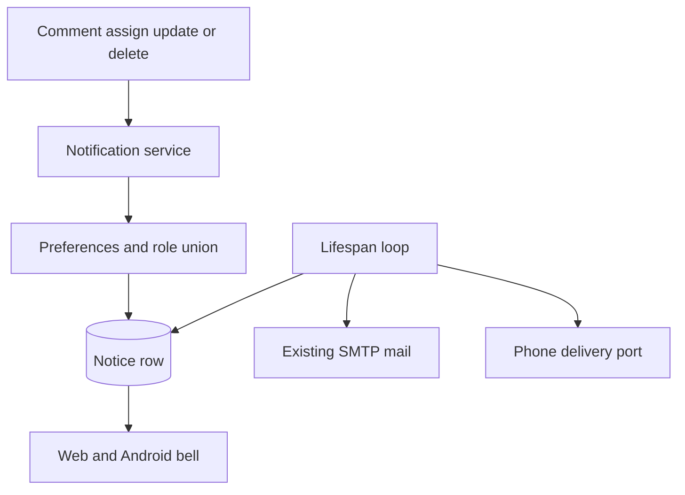

# App notification system

* **Status:** Accepted
* **Date:** 2026-11-11

## Background

KEEL-18 asks for notifications on the website and the Android app. Each person chooses, per event type, any combination of email, a phone alert, and the in-app bell. The bell starts on. Email and the phone alert stay off until turned on. All three off means not subscribed.

Keel is the self-hosted FastAPI app on the Pi, with SQLite, SMTP already used for password reset ([Email password reset](email-password-reset.md), `src/keel/services/mail.py`), and the Expo app in `mobile/`. There is no notification table, no live connection to browsers, and no push provider. The website saves one field per request. Field history already records what changed. The top bar's right side is Admin when that menu is shown, then Help, then the account. The Android bar is menu, title, connection mark, then profile initials.

[System context](../architecture/context.md) left external notification services out of v1. This story adds them on purpose. [Android app shell](android-app-shell.md) left notifications for this story.

## Problem Statement

People learn about comments, assignment, edits, and deletions only by opening the issue. There is no place to turn those events on or off, no shared inbox, and no defined way for a closed phone to be told. Unread notices must not sit on the Pi forever, and the website and the phone must show the same inbox.

## Objective(s)

* Tell a person when someone else comments on, assigns them, updates, or deletes an issue they created or are assigned to.
* Let each person choose email, phone alert, and the bell independently for each of those types.
* Show one inbox on the website and in the Android app, with the same unread dot.
* Send email through the SMTP settings that already exist.
* Deliver a phone alert while the Android app is closed. The owner turns on either Firebase or ntfy in server settings.
* Cap how long notices stay on the server, with those limits in server settings.

## Scope and Deliverables

### In-Scope

* Seven types: comment on an issue you created, comment on an issue you are assigned to, assigned to you, update on an issue you created, update on an issue you are assigned to, delete of an issue you created, delete of an issue you are assigned to.
* One notice when you are both creator and assignee. A channel is used when either matching preference has it on.
* The person who made the change gets no notice.
* An update notice that lists the fields changed. Further edits by the same person on the same issue, during the quiet period, grow that same notice.
* Server-stored inbox. Delete 3 days after read and 14 days after issued, whichever is sooner. Both values are server settings. The person can delete a notice at any time.
* A bell with an unread dot, and a notifications page, on the web and on Android.
* Preference screens on the web profile and the Android account screen.
* Email for types that have email on.
* Phone delivery through one configured provider: Firebase Cloud Messaging or ntfy.

### Out-of-Scope

* Sending through both providers at once. Empty `KEEL_PUSH_PROVIDER` sends nothing.
* A phone alert when that channel is off for the event type.
* iPhone, browser operating-system notifications, watchers, @mentions, digests, and chat integrations.
* Notices for your own change, for comment edits or comment deletions, or for unassign.
* An assignee change also counting as an "issue updated" notice. Assignment has its own type, and only the new assignee is notified.
* Backfill of old activity, and a feature flag.
* A second config system. Limits live in the existing `KEEL_*` settings and `.env`, beside SMTP and request-log retention.

### Deliverables

* This ADR.
* Six subtasks under KEEL-18:
  * KEEL-160 stores preferences and the inbox, including retention.
  * KEEL-161 records notices when issues change.
  * KEEL-162 sends notification email.
  * KEEL-163 shows the bell, the page, and the preferences on the website.
  * KEEL-164 shows the bell, the page, and the preferences in the Android app.
  * KEEL-165 delivers Android phone alerts through Firebase or ntfy, chosen in settings.

## Technical Requirements

* **Must** store notices and per-user, per-type channel preferences on the server. A missing preference means the bell is on and email and phone alert are off.
* **Must** skip the actor. When the recipient is both creator and assignee, **Must** write one notice and turn a channel on if either preference has it on.
* **Must** record an update as one notice listing each changed field. Comments, assignment, and deletion stay their own notices.
* **Must** show the update notice on the first change. Further field edits by the same actor on the same issue, inside the quiet period, update that notice's text. Email and the phone alert for that notice wait until the quiet period has passed since the last edit, then send once with the full list.
* **Must** send comment, assignment, and deletion notices immediately.
* **Must** read the quiet period from settings. Default 5 minutes. `KEEL_NOTIFICATION_UPDATE_QUIET_MINUTES=0` sends the update email and phone alert at the end of the request, with the fields that request changed.
* **Must** delete a notice at the earlier of read-time plus the read retention and issued-time plus the issued retention. Defaults are 3 days and 14 days, via `KEEL_NOTIFICATION_READ_RETENTION_DAYS` and `KEEL_NOTIFICATION_ISSUED_RETENTION_DAYS`. `0` turns that one cap off.
* **May** let the person delete a notice sooner from the page.
* **Must** keep the issue key and title on the notice, so a deleted issue stays readable and has no link.
* **Must** mark every notice read when the person views the notifications page. Deleting a notice is separate and is not required to clear the dot. The web and Android share that unread state.
* **Must** show a dot on the bell only when any notice is unread, and no count. At zero unread, the bell has no dot.
* **Must** list notices newest first. An empty page says there are no notifications. Opening one goes to the issue when it still exists.
* **Must** put the web bell in the top bar, immediately left of Admin when Admin is shown, and immediately left of Help otherwise.
* **Must** put the Android bell between the connection mark and the profile initials in `AppBar`.
* **Must** put the preference grid on the web profile and on the Android account screen.
* **Must** send email with the existing SMTP helper. If SMTP is unset or the send fails, the issue save still succeeds and the in-app notice remains.
* **Must** send a phone alert through the one provider named by `KEEL_PUSH_PROVIDER`. `fcm` uses Firebase and the phones that registered a token. `ntfy` publishes to that person's secret topic. An empty provider, a missing credential, or a failed send leaves the notice unstamped and does not fail the issue save.
* **Must** refresh the dot when a page or screen opens, and about every 30 seconds while the site or app is open.
* **May** cache the list on the phone for offline display. The server copy wins when the phone is online again.
* **Must** cover preference defaults, who is notified, bundling, and retention with service tests; the bell, page, and profile grid with web tests; and the dot and list with mobile tests.
* **Must Not** notify the actor, watchers, or people who only commented.
* **Must Not** send a phone alert through a provider the owner did not select.
* **Must Not** keep unread notices past the issued retention when that cap is on.

## Consequences

* **Good:** Web and Android share one inbox and one unread dot. Email stays off until someone turns it on.
* **Good:** Field-by-field web saves become one notice and one email.
* **Good:** Old notices leave the Pi on a schedule, and both caps are server settings. `0` disables a cap, the same rule the request log already uses.
* **Bad:** Update email and phone alerts wait for the quiet period. The bell updates on the first save.
* **Bad:** Firebase reaches the phone on any internet connection and needs a Firebase project, a service-account file on the server, and `google-services.json` in the locally built APK. ntfy needs no Google account. Its alert arrives only while the phone can reach the Pi, and the ntfy app shows it.
* **Risk:** A server restart during the quiet period must not drop the pending email or phone alert. The due time is stored on the notice. The lifespan loop sends notices whose due time has passed after the process is back, the same loop that rolls sprints forward.
* **Risk:** A phone alert away from home needs Firebase, or Tailscale so the phone can reach ntfy on the Pi. The ntfy topic is the secret. The server token, when set, stays on the server.

## System Design

### Technical Stack and Architecture

The notification rules live in one service used by the web forms and the JSON API. Routes do not decide who is notified. That follows [Layered module structure](layered-module-structure.md).

A notice row holds the recipient, the type, the actor, the issue id when the issue still exists, the snapshotted key and title, the body, the read time, the created time, and the time email and phone delivery are due. Preference rows are written when someone changes a default.

Settings, on `KeelSettings` and `.env`:

* `KEEL_NOTIFICATION_READ_RETENTION_DAYS` (default 3)
* `KEEL_NOTIFICATION_ISSUED_RETENTION_DAYS` (default 14)
* `KEEL_NOTIFICATION_UPDATE_QUIET_MINUTES` (default 5)
* `KEEL_PUSH_PROVIDER` (empty, `fcm`, or `ntfy`)
* `KEEL_FCM_CREDENTIALS_FILE` (service-account JSON path, used when the provider is `fcm`)
* `KEEL_NTFY_BASE_URL` and optional `KEEL_NTFY_TOKEN` (used when the provider is `ntfy`)

The lifespan loop in `src/keel/app.py` sends due alerts and purges expired notices.

Phone delivery reads the provider at send time. Firebase posts one message per registered device token. ntfy posts once to the person's topic. The notice row and the preferences stay as they are.

### UML Diagrams



```mermaid
sequenceDiagram
  participant Actor
  participant Keel
  participant Recipient
  Actor->>Keel: Save a field
  Keel->>Keel: Open or grow the update notice
  Recipient->>Keel: Open the site or app
  Keel-->>Recipient: Unread dot and the growing text
  Note over Keel: Quiet period after the last edit
  Keel->>Recipient: One email and one phone alert if those channels are on
```

## Supporting Documentation

* [Email password reset](email-password-reset.md)
* [Android app shell](android-app-shell.md)
* [Layered module structure](layered-module-structure.md)
* [System context](../architecture/context.md)
