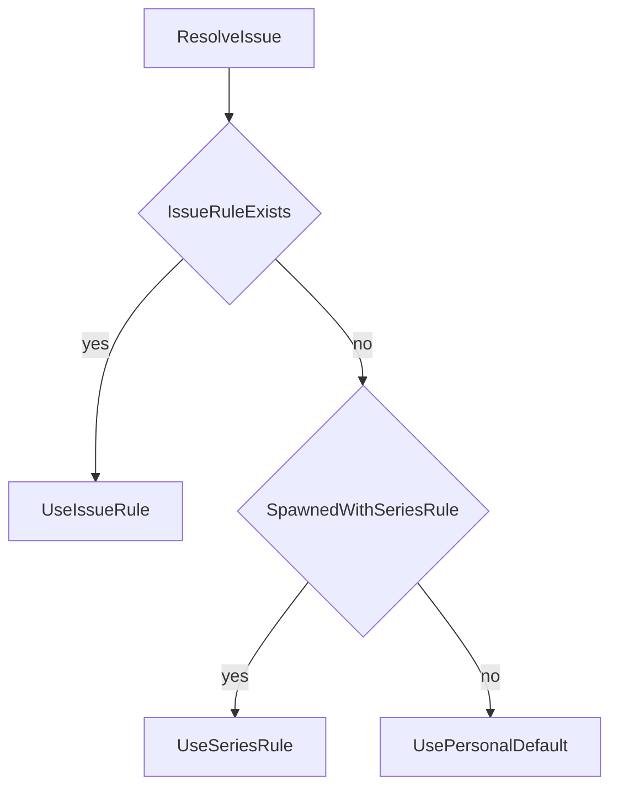
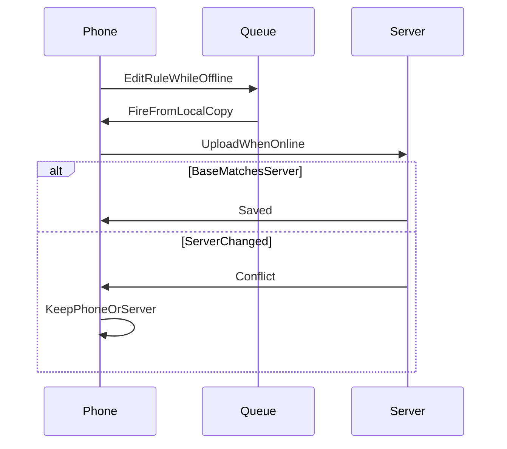
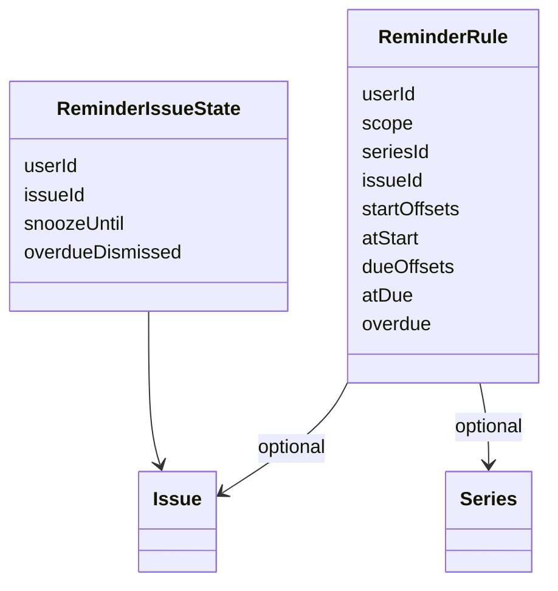

# App reminders

* **Status:** Accepted
* **Date:** 2026-11-18

## Background

KEEL-101 asks for calendar-style reminders around an issue’s start and due time. Each person sets their own. A reminder hangs off an issue or a series, and it stays out of the issue record.

Keel already records activity notices for comments, assignment, edits, and deletes. That inbox is the bell, email, and a phone push through Firebase or ntfy ([App notification system](app-notification-system.md)). The Android app already schedules nothing on its own clock. It registers a push token in `mobile/App.js` and stores offline issue edits in `mobile/src/offline.js` ([Android offline mode](android-offline-mode.md)). A series can spawn a tree of issues, and each item has its own start and due ([Structured scheduled issues](structured-scheduled-issues.md)).

Issue `start_at` and `due_at` are naive wall times. There is no per-user timezone.

## Problem Statement

People have to open Keel to notice that work is about to start, is due, or is late. Activity notices do not fire on a clock, and a server push cannot fire while the phone is offline or offline mode is locked.

## Objective(s)

* Let each person turn on several lead times before start, a reminder at start, several lead times before due, a reminder at due, and a repeating overdue reminder until the issue is done or cancelled.
* Let them keep a personal default, replace it for a series, and replace that for one issue.
* Fire an Android notification with the app closed and with no network.
* Fire a browser notification while a Keel tab is open and the computer is awake.
* Let the phone add, change, and turn off reminders with no network, then sync, and ask which copy to keep when both sides changed.

## Scope and Deliverables

### In-Scope

* Personal default, series rule, and issue rule for the signed-in user.
* A series rule covers every issue that occurrence spawns, root and children, until that issue has its own rule. Each issue uses its own start and due.
* Android local notifications, including while offline mode is locked.
* A browser notification and an on-page Snooze and Dismiss while a Keel tab is open.
* Snooze and Dismiss for overdue only. Snooze pauses until a time the person picks, fires then, and resumes the interval. Dismiss stops overdue on that issue until they turn it back on. The series rule stays as it is.
* Phone offline edits, upload, and a phone-copy or server-copy choice.
* Lead times in minutes, hours, or days. Overdue is every N minutes, hours, or days, or every day at a clock time.

### Out-of-Scope

* Email, the activity bell, Firebase, ntfy, and any other server push as the reminder clock.
* Browser push, a service worker, and a reminder while the Keel tab is closed.
* Editing reminders on the website while the server is unreachable.
* iPhone.
* Snooze or dismiss on a lead-time, at-start, or at-due reminder. Those fire once.
* Writing reminder rules into issue history, rollup, or the activity notice types.
* A long-running background process.
* A feature flag or a new secret.

### Deliverables

* This ADR.
* The later build, only when asked: server rules, web editors and the open-tab clock, Android scheduling and the offline queue, and tests.

## Technical Requirements

* **Must** store rules per user. One user’s rule has no effect on another user.
* **Must** resolve one effective rule per user per issue: the issue rule if it exists, otherwise the series rule when the issue was spawned by that series, otherwise the personal default.
* **Must** treat a saved rule as a full replacement of what it overrides. An empty rule turns every moment off and stops inheritance. Deleting an issue rule returns that issue to the series rule or the default. Deleting a series rule returns inheriting issues to the default.
* **Must** start a new person with no default, so nothing fires until they add one.
* **Must** allow more than one lead time on start and more than one on due. Units are minutes, hours, and days, with an amount of at least 1. Duplicate offsets on one anchor collapse to one.
* **May** cap each anchor at 20 offsets.
* **Must** keep at-start and at-due as their own on or off switches.
* **Must** keep a single overdue repeat: every N minutes, hours, or days, or every day at a minute of the day. The at-due reminder fires at due. The first overdue fire is one duration after due, or the next clock time strictly after due.
* **Must** stop future one-shots and overdue when the issue is done or cancelled, and schedule again if it is reopened while the rule is still on.
* **Must** skip an anchor that has no time, and say so in the editor. Changing a start or due time reschedules that anchor.
* **Must** interpret stored wall times in the device’s local timezone.
* **Must** catch up once, when the phone is on again or a Keel tab opens, for a fire time that passed while that rule was already on and the issue is still open. Overdue catch-up is one notice, then the next fire is one interval after now, or the next clock time after now.
* **Must** schedule only future instants when a rule is saved. Past one-shots are skipped. An issue that is already overdue starts at the next interval from now, or the next clock time.
* **Must** store snooze-until and overdue-dismissed per user per issue, separate from the series rule. The next overdue fire after snooze is the chosen time, then the interval continues from that time. A snooze time in the past catch-up fires once and then resumes. Dismiss suppresses overdue on that issue until resume. Lead-time, at-start, and at-due reminders still fire.
* **Must** let Snooze and Dismiss run from the Android notification. Snooze opens a time picker. Dismiss applies immediately. Tapping the notification body opens the issue.
* **Must** show Snooze and Dismiss on the open Keel page when a browser reminder fires. The browser notification click focuses that page. Action buttons on a browser notification need a service worker, which this decision leaves out.
* **Must** allow the phone and an open tab to fire the same instant. Snooze and dismiss sync when the device that made them is online. The other surface follows after it sees the sync.
* **Must** schedule Android reminders with the operating system through `expo-notifications`, including with the app closed. Pre-schedule at most 32 upcoming overdue instants, and refill that list when the app opens or a reminder is delivered.
* **Must** keep firing and queue reminder edits while the phone has no network and while offline mode is locked. Upload when the phone is online again and the lock is off.
* **Must** ask the person to keep the phone copy or the server copy when a queued edit meets a server rule that changed after the phone’s base. Until they choose, the phone keeps firing the copy it has.
* **Must** queue a reminder for an issue that is still waiting for its first upload, and send it after the issue has a server id.
* **Must** cancel schedules for an issue the user can no longer view, an issue that was deleted, or a series rule whose series was deleted. Spawned issues remain. Issues that were inheriting the deleted series rule fall back to the default.
* **Must** put the default on the web profile and the Android account screen, the issue rule on the issue page, and the series rule in the series editor, on the web and on Android. Show whether the effective rule comes from the issue, the series, or the default, and offer reset.
* **Must** leave rules in place when notification permission is denied, and explain how to allow them. If Android denies exact alarms, say that reminders may be late.
* **Must** share one set of clock fixtures between the Python scheduler and the phone scheduler, and test both against those fixtures.
* **Must** keep activity notices, email, and phone push on their current path in `src/keel/services/notifications.py`.
* **Must Not** fire a reminder through `KEEL_PUSH_PROVIDER`, and **Must Not** create an activity notice for a reminder.
* **Must Not** add a service worker, web push keys, or a persistent background process.
* **Must Not** require the website to save a reminder edit while the server is down. Timers already armed in an open tab keep running until the tab closes or the page reloads.
* **May** group reasons that land on the same minute for the same issue into one notification.

## Consequences

* **Good:** The phone reminds the person with the app closed and with no network. Each person controls their own default, series, and issue rules. Activity notices stay unchanged.
* **Bad:** The website is silent while the tab is closed. Browser Snooze and Dismiss live on the page, because a closed-tab notification action would need a service worker. The phone carries a second copy of the clock math.
* **Risk:** A phone set to another timezone interprets naive wall times differently from the Pi. Exact-alarm permission can delay Android delivery. A killed app only fires overdue instants that were already scheduled, until the next refill. Two surfaces can both chime until snooze or dismiss has synced.

## System Design

### Technical Stack and Architecture

The server remains the source of truth after a successful upload. SQLite stores the rules. The website stays server-rendered Jinja. The open tab asks for the caller’s upcoming instants and arms page timers. The phone computes the same instants from its saved issues and rules so a local date edit reschedules with no network.

Rejected clocks: server push cannot fire offline; a foreground service spends battery the ticket says to avoid; putting the rule on the issue row would publish one person’s reminders to everyone and would record them as issue edits.

New server pieces sit beside the current profile and issue API:

* `GET` and `PUT /api/v1/profile/reminders` for the default
* `GET`, `PUT`, and `DELETE /api/v1/series/{series_id}/reminder`
* `GET`, `PUT`, and `DELETE /api/v1/issues/{issue_id}/reminder`
* `GET /api/v1/reminders/schedule` for the website tab and for an online refill
* `PUT /api/v1/issues/{issue_id}/reminder/snooze`, `POST .../dismiss-overdue`, and `POST .../resume-overdue`

The phone’s offline queue follows `choosePhone` and `chooseServer` in `mobile/src/offline.js`. Editors land on `src/keel/web/templates/profile.html`, `src/keel/web/templates/issue_detail.html`, the schedule editor in `src/keel/web/routes/schedules.py`, and the matching Android account, issue, and schedule screens. A new Android channel, Reminders, carries these alerts. The existing Alerts channel stays on the activity push path.

### UML Diagrams

## Named assumptions

* Anyone who can view the issue may set a reminder on it.
* One notification per issue per minute lists every reason that landed then.
* A duration overdue repeats by adding that duration. A daily clock time repeats on the next local day at that minute.
* The website banner is the browser’s Snooze and Dismiss. Android puts those actions on the notification itself.
* Verification is fixture tests for both clocks, API tests, web form tests, and phone queue tests. CI does not post a real OS notification.

## Later build

When asked to build, the slices are the migration and models, the Python clock and shared fixtures, the JSON API, the web editors and open-tab timers, the Android schedule plus offline queue and conflict choice, and the tests above.

## Supporting Documentation

* [App notification system](app-notification-system.md)
* [Android offline mode](android-offline-mode.md)
* [Android app shell](android-app-shell.md)
* [Structured scheduled issues](structured-scheduled-issues.md)
* [Repeating work via Scheduling Manager](repeating-work-scheduling-manager.md)
