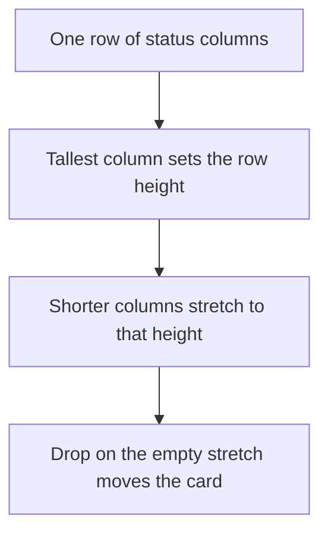

# Board columns fill the row

* **Status:** Accepted
* **Date:** 2026-11-06
* **Updated:** 2026-11-14 — the filter bar scrolls with the cards and can be minimized ([Collapsible board filters](collapsible-board-filters.md)). The requirement below that kept the filters in place is superseded for that bar. The top bar and the page title still stay put.

## Background

The Kanban lays status columns in a row, and stacks one such row per sprint when the board is separated by sprint ([ADR 013](planning-realization.md)). A card moves by dragging onto a column, or by the Move control when dragging is unavailable ([ADR 009](server-rendered-jinja2.md)). The row sized each column to its own cards, so a short column stopped near the top of a tall one.

## Problem Statement

A card at the bottom of a tall column sits beside empty page, not beside the other columns. Dropping it on another status means scrolling back up to the short column. The same gap appears on a project board and on `/board`, and in a single shared row (`by=status`).

## Objective(s)

- Let a card at the bottom of a row drop on any other column in that row without scrolling up.
- Keep the column's shaded body as the drop target for that whole height.
- Leave sprint collapse, filters, and the Move fallback as they are.

## Scope and Deliverables

### In-Scope

* Status columns in one `.keel-board` row sharing the height of the tallest column.
* The card list growing to fill that column, on a project board and on `/board`.
* The same stretch when the board is one shared row and when it is separated by sprint.

### Out-of-Scope

* Making a sprint row as tall as the viewport, or stretching one sprint row down into the next.
* Changing which sprint or status a drop writes.
* The phone app. Its board is a separate client.
* Drag-and-drop on a phone-narrow viewport, which keeps the Move control because a finger drag is unreliable ([Phone layout of the existing site](phone-layout.md)).

### Deliverables

* This ADR as the behavior source of truth.
* The row and column rules in `assets/brand.css`.

## Technical Requirements

* **Must** stretch every status column in a row to the height of the tallest column in that row.
* **Must** let the card list fill the column below its heading, so the empty stretch is inside the column that accepts a drop.
* **Must** keep each status heading visible at the top of the board pane while that row's cards scroll.
* **Must** leave the top bar and the page title in place while the cards scroll. The filter bar scrolls with the cards ([Collapsible board filters](collapsible-board-filters.md)).
* **Must** apply on a project board and on `/board`, whether or not the board is separated by sprint.
* **Must** keep a readable column width and sideways swipe on a phone-narrow viewport.
* **Must Not** change the Move fallback, sprint-row collapse, or the JSON board.
* **Must Not** give a sprint row a viewport minimum height. A short sprint stays only as tall as its tallest column.

## Consequences

* **Good:** A card at the bottom of a row can move to a shorter column in that row without scrolling up to that column's cards.
* **Bad:** A short column shows a long empty shaded body beside a tall one. That empty body is the drop target.
* **Risk:** On a phone-narrow viewport the columns still swipe sideways, and a stretched column is taller. Status changes there still use Move.

## System Design

### Technical Stack and Architecture

This is presentation on the HTML board. `.keel-board` is a row flex with `align-items: stretch`. Each `.keel-board__column` is a column flex, and `.keel-board__cards` grows to fill it. `board.js` already listens for a drop on the column, so the empty stretch accepts the card. On the board page the cards scroll in `.keel-board-scroll`, and each `.keel-board__heading` is `position: sticky` against that pane. The filter bar sits in that same pane, so it scrolls away; the page title stays above the pane. The row itself does not scroll, so the heading is not trapped. No new route and no script change.

### UML Diagrams

## Supporting Documentation

* [UI design](../design/ui.md)
* [Use cases](../architecture/use-cases.md)
* [ADR 013: Planning realization](planning-realization.md)
* [ADR 009: Server-rendered Jinja2 pages with vanilla JavaScript](server-rendered-jinja2.md)
* [Phone layout of the existing site](phone-layout.md)
