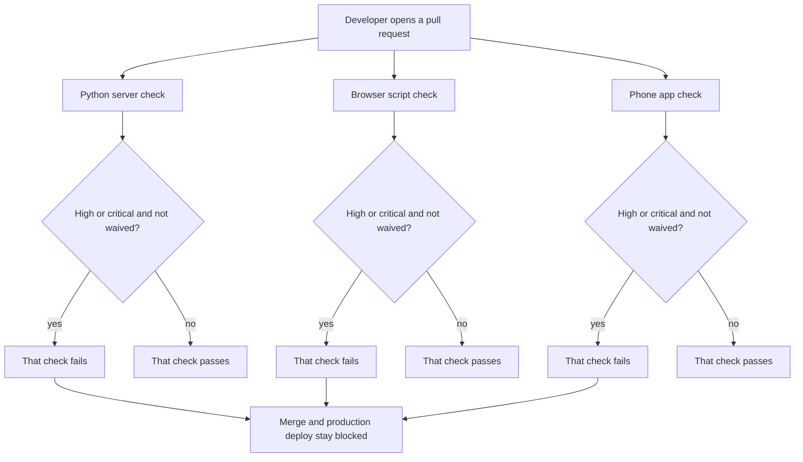

# Code security checks

* **Status:** Accepted
* **Date:** 2026-11-01

> **Amendment.** A commit runs each scan through pre-commit, and skips that scan when the commit includes no file that scan covers. `poe check` runs every hook on all files, so it runs all three. CI still has the three jobs.

## Background

CI already fails when a published advisory matches a Python package the server installs ([Dependency vulnerability checks](dependency-vulnerability-checks.md)). That check does not read Keel’s own source. Ruff in CI checks style and correctness only. Nothing scans the Python server, the browser scripts in `assets/js`, or the phone app in `mobile/` for security flaws in code we wrote. A pull request can merge, and the Raspberry Pi deploy that waits on CI can install it, with that kind of flaw still in the tree.

## Problem Statement

A security flaw in code we wrote can ship while CI is green. The dependency audit cannot see it. Developers have no check, per app, that fails on a serious flaw in the code that actually runs.

## Objective(s)

- Give each app its own CI check for security flaws in the code that ships.
- Fail that check on a high or critical finding unless that exact finding is waived on the line.
- Show lower findings without failing the check.
- Keep a rule that is off for a whole app in that app’s config, with a reason.

## Scope and Deliverables

### In-Scope

- One check for the Python server’s shipping code.
- One check for the browser scripts’ shipping code.
- One check for the phone app’s shipping code.
- A failure when that check reports a high or critical finding with no waiver.
- A waiver written on the line, in a form the scanner reads, naming that finding and why it is allowed.
- A config for each app where a rule turned off for the whole app is listed with a reason.
- The same three checks runnable locally, with the same pass or fail result as CI.

### Out-of-Scope

- Tests. A finding in a test does not fail these checks, because tests are not scanned.
- The dependency vulnerability check. It stays a separate check.
- Secret scanning, container-image scanning, and scanning dependencies of the phone app.
- A second copy of each waiver in the decision record. The line is the list a reviewer reads in the diff.
- Changing what the running server or the phone app shows to a person using Keel.

### Deliverables

- Three CI checks, one per app, on the workflow Deploy already waits on.
- A local way to run each check.
- Per-app config for rules turned off for that whole app.
- This record.

## Technical Requirements

* **Must** run three separate checks in CI: the Python server, the browser scripts, and the phone app.
* **Must** scan only the shipping code of that app.
* **Must Not** scan tests.
* **Must** fail that app’s check when the scan reports a high or critical finding that has no waiver.
* **Must** show lower findings in that check’s output.
* **Must Not** fail a check only because of lower findings.
* **Must** treat a waiver as a suppression on the finding’s line that the scanner reads, naming that finding and giving a reason.
* **Must Not** treat a comment the scanner does not read as a waiver.
* **Must Not** let one line suppression waive every finding, or waive a rule for the whole file or app.
* **Must** put a rule that is turned off for an entire app in that app’s config, with a reason.
* **Must Not** let one app’s config turn a rule off for either of the other apps.
* **Must** fail that app’s check if the scan cannot finish.
* **Must** leave Deploy waiting on the CI workflow, so any failed check blocks the production update.
* **Must** keep the dependency vulnerability check as its own check.
* **Must** run each scan from pre-commit when the commit includes a file that scan covers.
* **Must** skip that scan on commit when the commit includes no such file.
* **Must** run all three scans from `poe check`, because that runs every hook on all files.
* **May** be run on their own before push, with the same pass or fail result CI would give.

## Consequences

* **Good:** A high or critical flaw in code that ships fails CI before merge, and the reason for an allowed finding is on the line in the diff. Each app can fail on its own.
* **Bad:** Lower findings can remain forever without failing CI. Three results have to be read instead of one.
* **Risk:** A suppression broader than one finding, or a config entry with a weak reason, hides a later flaw of the same kind. A reviewer has to look at the line; there is no separate list of waivers.

## System Design

### Technical Stack and Architecture

This touches the CI workflow developers already watch, and the three shipping trees: the Python server, the hand-written browser scripts, and the phone app. It does not add a screen, a role, or a change to the running product. The dependency audit remains the check for packages that are installed, not for source we wrote. Which scanner each app uses is an implementation choice, as long as it can do what the requirements say: fail on high or critical, show lower findings, read a line suppression, and read a per-app config for a rule that is off everywhere in that app.

The Python check runs Bandit on `src/keel`. Bandit has no critical tier, so a HIGH finding is what fails that check. The browser and phone checks run ESLint with `eslint-plugin-security` on `assets/js` and on the phone’s shipping JavaScript. Rules set to error are the high findings. Rules set to warn are shown and do not fail the check. `scan/python.json`, `scan/browser.json`, and `scan/phone.json` are the three configs. A later edit to one does not change the others.

The same three commands are pre-commit hooks. Pre-commit runs a hook only when a staged file matches that hook, so a commit that leaves an app untouched skips that app’s scan. A phone test does not match the phone hook. `poe check` passes every file to the hooks, so it runs all three scans.

### UML Diagrams

## Supporting Documentation

* [Dependency vulnerability checks](dependency-vulnerability-checks.md)
* [CI workflow](../../.github/workflows/ci.yml)
* [Contributing](../../.github/CONTRIBUTING.md)

## Assumptions

- A scan that cannot finish fails that app’s check, same as a high finding with no waiver.
- “Shown” for a lower finding means it appears in that check’s output. It does not open a ticket or send a notice.
- The decision record states this policy. It does not repeat each inline waiver.
- Tool choice per app is an implementation detail. It does not change the behavior above.
