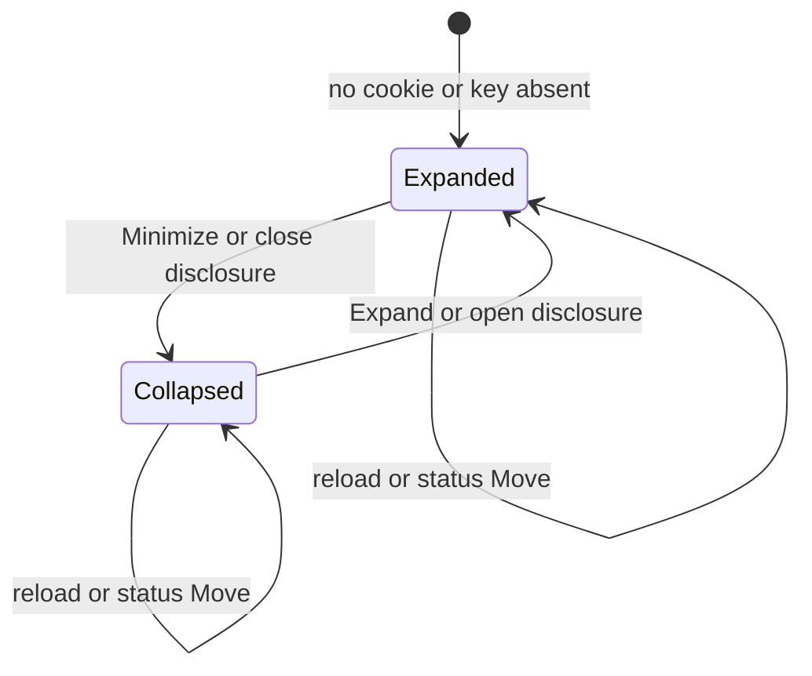
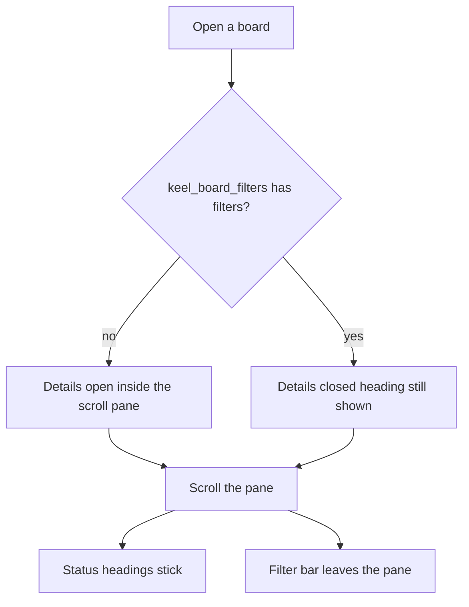

# Collapsible board filters

* **Status:** Accepted
* **Date:** 2026-11-14

## Background

The Kanban keeps the top bar and the page title fixed, and scrolls the cards in a pane beneath them. Each status heading sticks to the top of that pane ([Board columns fill the row](board-columns-fill-the-row.md)). That same pane used to start below the filter bar, so the filters stayed on screen for the whole scroll. Home, the issue page, and sprint rows already minimize with a native disclosure and a browser cookie ([Collapsible home inbox sections](collapsible-home-inbox-sections.md), [Foldable issue panels](foldable-issue-panels.md), [Collapsible board sprint lanes](collapsible-board-sprint-lanes.md)). KEEL-141 asks for the filter bar to stop occupying the pane, and to minimize the same way.

## Problem Statement

The filter bar stays pinned above the cards. On a short screen it can take half the pane or more, and scrolling the cards does not move it. There is no way to leave a heading and hide the fields, and a collapse that vanished on the next reload would not help.

## Objective(s)

- Let the filter bar scroll away with the cards while each status heading stays at the top of the pane.
- Let people minimize the filter bar while leaving its heading visible.
- Keep that choice across reloads, filter changes, and status moves, on a project board and on `/board`.
- Keep the board usable without JavaScript and on a phone-narrow viewport.

## Scope and Deliverables

### In-Scope

* The shared filter bar on a project board and on `/board`, inside the card scroll pane.
* A native disclosure around that bar, defaulting to open.
* A browser cookie holding whether the bar is collapsed.
* A no-JavaScript Minimize and Expand, and a save from `board.js` when the disclosure toggles.
* The filter bar staying at the left edge while columns swipe sideways.
* Doc updates so the UI map and use cases describe the control.

### Out-of-Scope

* The calendar and the gantt. Their pages scroll as a whole, and this change does not wrap their filter bar.
* The phone app. Its board is a separate client.
* Removing the filter bar with no heading left behind.
* Changing which fields the bar has, or which issues match.
* Storing the preference on the user row or in the database.
* Collapsing sprint rows. That stays [Collapsible board sprint lanes](collapsible-board-sprint-lanes.md).

### Deliverables

* This ADR as the behavior source of truth.
* The disclosure on the HTML board and the cookie that remembers it.

## Technical Requirements

* **Must** place the filter bar inside the board scroll pane, on a project board and on `/board`, so scrolling the cards carries the bar off the pane.
* **Must** keep each status heading visible at the top of that pane while that row's cards scroll.
* **Must** leave the top bar and the page title in place while the cards scroll.
* **Must** wrap the filter bar in a native disclosure whose summary is a Filters heading.
* **Must** default the bar to expanded when the cookie is missing or empty.
* **Must** keep the heading visible when the bar is collapsed, and **Must** keep the filter controls in the page so expanding does not need a second fetch.
* **Must** persist the collapsed bar in a `keel_board_filters` cookie on this browser, the same regardless of who is signed in, and the same cookie on a project board and on `/board`.
* **Must** store only the known key `filters`, dropping unknowns. An empty cookie means the bar is open.
* **Must** restore the choice on every render of either board, including after a status change that returns there.
* **Must** work without JavaScript: Minimize and Expand post to `/web/board-filters` and redirect back to the same board path, including its query. An off-site return path is refused.
* **May** hide Minimize and Expand after `board.js` has run and persist instead from the disclosure's `toggle` event.
* **Must** keep the filter bar at the left of the pane while columns swipe sideways on a phone-narrow viewport.
* **Must** keep drag-and-drop, the Move fallback, filter matching, Separate by sprint, and sprint-row collapse as they are.
* **Must Not** change the calendar or gantt filter bar.
* **Must Not** change the JSON board.
* **Must Not** persist the choice in SQLite or key it to the acting user.

## Consequences

* **Good:** Scrolling the cards gives the columns the pane. The status names stay visible. A person who is done with the fields can fold them and keep that on the next visit.
* **Bad:** The same browser shares one choice across signed-in people. Folding the bar hides Separate by sprint until it is expanded.
* **Risk:** An open filter menu near the bottom of a short pane can be clipped by the scroll pane. The menu still opens over the cards when the bar is at the top of the pane.

## System Design

### Technical Stack and Architecture

This is a presentation choice on the HTML board. The filter bar moves inside `.keel-board-scroll`. `.keel-board-filters` is `position: sticky` on the left only, so a sideways swipe does not take it with the columns, and a downward scroll does. `keel.web.board_filters` parses and updates the cookie. The form posts to `/web/board-filters`. `board.js` already loads only on the board; it also posts when the filter disclosure toggles. No new table and no JSON route.

### UML Diagrams

## Supporting Documentation

* [UI design](../design/ui.md)
* [Use cases](../architecture/use-cases.md)
* [Board columns fill the row](board-columns-fill-the-row.md)
* [Common filtering](common-filtering.md)
* [Collapsible board sprint lanes](collapsible-board-sprint-lanes.md)
* [Collapsible home inbox sections](collapsible-home-inbox-sections.md)
* [Foldable issue panels](foldable-issue-panels.md)
