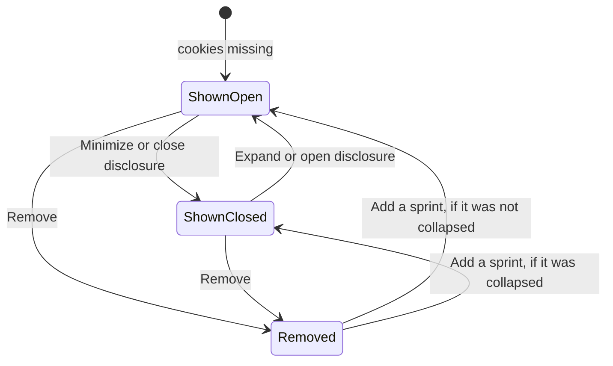
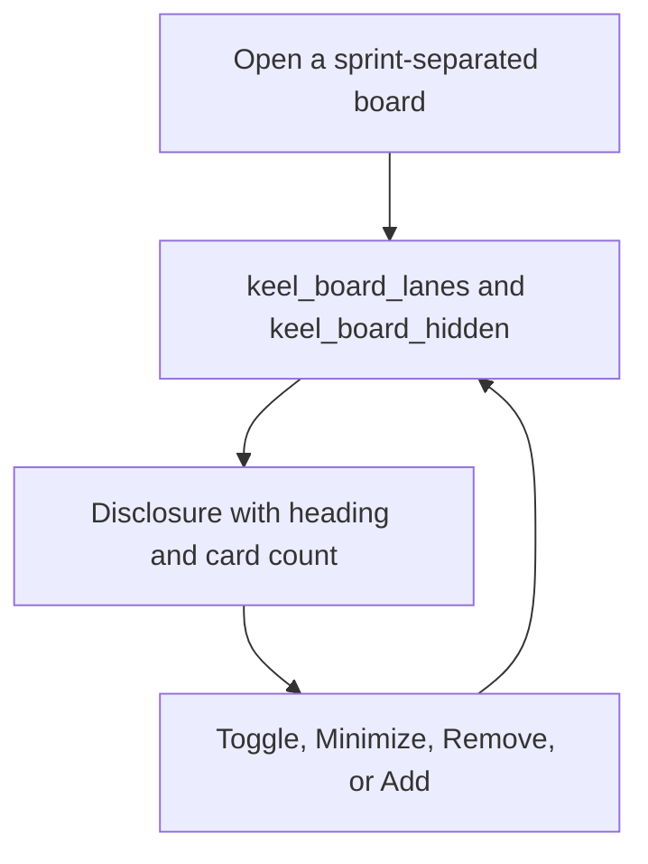

# Collapsible board sprint lanes

* **Status:** Accepted
* **Date:** 2026-11-02

## Background

The Kanban stacks a row of status columns per sprint, including Unscheduled, and that layout is the default ([ADR 013](planning-realization.md)). A long list of planned sprints, or a sprint the person is not working, still takes a full row of columns. Home already lets this browser minimize a section or take it off the page, and remembers that in cookies rather than on the user row ([Collapsible home inbox sections](collapsible-home-inbox-sections.md), [Customizable home panels](customizable-home-panels.md)). KEEL-93 asks for the same minimize and hide on the board's sprint rows.

## Problem Statement

Every sprint row is always fully open and always on the page. Minimizing a home panel does not help once the person is on the board. A collapse that vanished on the next card move would not help either, and hiding a row must not delete the sprint or its issues.

## Objective(s)

- Let people minimize any sprint row while leaving its heading visible.
- Let this browser remove a sprint row and add it back.
- Keep that choice across reloads, filter changes, and status moves.
- Keep the board usable without JavaScript and on a phone-narrow viewport.

## Scope and Deliverables

### In-Scope

* Native disclosure on each sprint row when the board is separated by sprint, on a project board and on `/board`.
* A card count on the heading.
* Remove on each row, and Add a sprint for the rows that were removed and would otherwise be on this page.
* Two browser cookies: which rows are collapsed, and which are removed.
* A no-JavaScript form for each control, and a save from `board.js` when a disclosure toggles.
* Doc updates so the UI map and use cases describe the controls.

### Out-of-Scope

* Reordering sprint rows.
* Applying the cookies when the board is one shared row of columns (`by=status`). That layout still shows every card the filters allow.
* Changing sprint membership, deleting a sprint, or omitting its cards from the JSON board.
* The phone app. Its board is one row of status columns, not sprint rows.
* Storing the preference on the user row or in the database.
* Collapsing anything on the board other than a sprint row.

### Deliverables

* This ADR as the behavior source of truth.
* The controls on the HTML board and the cookies that remember them.

## Technical Requirements

* **Must** wrap each sprint row, while the board is separated by sprint, in a native disclosure whose summary is that row's existing heading.
* **Must** default every row to expanded and shown when the cookies are missing or empty.
* **Must** keep the heading visible when the row is collapsed, and **Must** show how many cards the row holds.
* **Must** keep the columns in the page so expanding does not need a second fetch.
* **Must** offer Remove on each shown row. Removing it keeps that row off project boards and `/board` until it is added, including when it still has cards.
* **Must** offer Add a sprint listing every removed row that this page would have shown, by the same heading. Adding one puts the row back. A row that the current filters would not show stays out of that list until the filters include it, and stays removed once they do.
* **Must** persist collapsed rows in a `keel_board_lanes` cookie and removed rows in a `keel_board_hidden` cookie, on this browser, the same regardless of who is signed in.
* **Must** key a sprint by its id, so the same sprint is one row on a project board and on `/board`.
* **Must** key Unscheduled separately per project board (`unscheduled-{project id}`) and use `unscheduled` for the single Unscheduled row on `/board`.
* **Must** store only those keys, dotted, dropping unknowns, a leading zero, and anything past 200 keys on one cookie. An empty cookie means nothing is collapsed or nothing is removed.
* **Must** restore collapsed and removed rows on every render of a sprint-separated board, including after a status change that returns there.
* **Must** leave a collapsed row collapsed when a later save only reports the rows on the current page.
* **Must** work without JavaScript: Minimize, Expand, Remove, and Add post and redirect back to the same board path, including its query. An off-site return path is refused.
* **May** hide Minimize and Expand after `board.js` has run and persist instead from the disclosure's `toggle` event. Remove and Add a sprint stay visible.
* **Must** keep drag-and-drop, the Move fallback, filters, Separate by sprint, and phone-narrow sideways swipe of columns as they are.
* **Must Not** persist the choice in SQLite or key it to the acting user.
* **Must Not** change the JSON board. Lanes there are still every sprint the filters allow.

## Consequences

* **Good:** A person can fold the sprint they are not moving cards in, or take a sprint off the board, and still find it from the heading or from Add a sprint.
* **Good:** The choice survives a reload and a status Move because it lives in cookies.
* **Bad:** The same browser shares one choice across signed-in people. Hiding a sprint hides it on every board that would have shown that sprint.
* **Risk:** Removing every row on the page leaves "Every sprint is hidden." plus Add a sprint. The add control is on that page. `by=status` still shows the cards, which can look like the hide did not stick until Separate by sprint is on again.

## System Design

### Technical Stack and Architecture

This is a presentation choice on the HTML board. `keel.web.board_lanes` parses and updates the cookies. The forms post to `/web/board-lanes`, `/web/board-lanes/hide`, and `/web/board-lanes/show`. `board.js` already loads only on the board; it also posts the closed keys for the rows on the page, plus the keys of those rows, so a sprint that is filtered off the page stays collapsed. No new table and no JSON route.

### UML Diagrams

## Supporting Documentation

* [UI design](../design/ui.md)
* [Use cases](../architecture/use-cases.md)
* [ADR 013: Planning realization](planning-realization.md)
* [Collapsible home inbox sections](collapsible-home-inbox-sections.md)
* [Customizable home panels](customizable-home-panels.md)
* [ADR 009: Server-rendered Jinja2 pages with vanilla JavaScript](server-rendered-jinja2.md)
* [ADR 018: Phone layout of the existing site](phone-layout.md)
