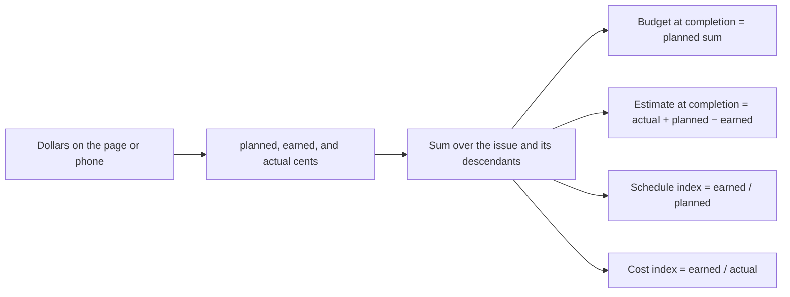

# Cost estimation

* **Status:** Accepted
* **Date:** 2026-11-02

## Background

An issue already stores estimated time and time remaining as whole minutes. A parent keeps its own numbers and also shows a subtree total ([ADR 012](issue-realization.md)). Cancelled descendants stay in the estimate total and drop out of remaining ([ADR 020](cancelled-status.md)). KEEL-118 asks for the same kind of optional tracking for cost, using the three earned-value measurements, plus the usual summary figures calculated from them.

## Problem Statement

There is nowhere to record what a piece of work was planned to cost, what was earned, or what was actually spent. A parent cannot show those amounts for its children, and the usual earned-value summaries — budget at completion, estimate at completion, and the schedule and cost performance indexes — have no inputs to be calculated from.

## Objective(s)

- Let a person record planned value, earned value, and actual cost on any issue.
- Roll those amounts up to parents the way effort rolls up, without replacing an issue's own values.
- Show budget at completion, estimate at completion, and the two performance indexes as calculated figures.

## Scope and Deliverables

### In-Scope

* Three optional integer columns on Issue, stored as cents: planned value (PV / BCWS), earned value (EV / BCWP), and actual cost (AC / ACWP).
* Create, read, and partial update of those columns through the JSON issue API.
* Dollar entry on the website issue page and Create form, and on the phone app's create, edit, and detail screens, including the offline queue.
* Rollup of the three amounts over the issue and every descendant.
* Calculated budget at completion, estimate at completion, schedule performance index, and cost performance index on that rollup.
* A history line for each of the three stored amounts.

### Out-of-Scope

* Exchange rates, or a currency of its own on one issue. The unit shown for these amounts is the project currency ([Project currency](project-currency.md)).
* Editing the four calculated figures, or storing them.
* Putting cost on a board card. Cards keep the content named in [ADR 032](ADR-032.md).
* A cost field on the series recipe. Spawned issues start with the three amounts unset.
* Charts, burndown, or any report beyond the figures on the issue.
* Dropping cancelled work out of the cost totals. Remaining time is the only total that omits cancelled descendants.

### Deliverables

* Columns, checks, and the history-field names in the schema and in migration `0030`.
* Rollup arithmetic in `keel.domain`.
* Website and phone controls for the three amounts, and read-only display of the four calculated figures.

## Technical Requirements

* **Must** store planned value, earned value, and actual cost as whole non-negative cents, nullable, default null.
* **Must** treat null as unset. Unset contributes nothing to a sum. An explicit zero is stored and does contribute.
* **Must** accept an amount of the form `12`, `12.50`, or `$1,234.56` on the website and the phone, in the project currency, and reject a negative amount. A symbol or code for a different currency is refused ([Project currency](project-currency.md)).
* **Must** exchange the three amounts as cents on the JSON API. A negative value is refused.
* **Must** show a parent both its own three amounts and a rolled-up total of itself and all descendants, including cancelled descendants.
* **Must Not** overwrite an issue's own amounts with a value derived from its children.
* **Must** set budget at completion to the rolled-up planned value. It is null when no planned value is set in the subtree.
* **Must** set estimate at completion to actual + (budget at completion − earned) when planned, earned, and actual totals are all present, and leave it null otherwise.
* **Must** set the schedule performance index to earned / planned, and the cost performance index to earned / actual, using the subtree totals. Each is null when its divisor is missing or zero, and otherwise rounded half up to four decimal places.
* **Must Not** accept the four calculated figures on create or update.
* **Must** append a history line when planned value, earned value, or actual cost changes, labeled in the project currency then in effect, with `none` when the amount is unset.
* **May** leave the three amounts blank. Nothing requires them before an issue can be done.

## Consequences

* **Good:** Cost follows the effort rules people already know: own value beside a subtree total, unset is not zero, and a parent never loses what was typed on it. The indexes are computed from the sums, so a parent does not average its children's indexes.
* **Bad:** Budget at completion is the planned-value total, not a separately entered project budget. If planned value is only the work scheduled so far, budget at completion understates the full budget.
* **Bad:** Estimate at completion assumes the work still to earn will be spent at the original rate. It does not assume the current cost index continues.
* **Risk:** The stored cents keep two decimal places of the major unit. A later change of currency relabels those digits; it does not convert them ([Project currency](project-currency.md)).
* **Risk:** Cancelled work stays in the cost totals, so a cancelled child's actual spend still raises the parent's actual cost. That matches money already spent; it will surprise anyone who expects cancellation to zero the rollup.

## System Design

### Technical Stack and Architecture

Parsing, formatting, and the index and estimate-at-completion formulas live in `keel.domain.money`. Summing lives in `keel.domain.rollup` next to the effort totals, still a pure function over the subtree. `keel.services.issues` checks non-negative cents, writes history, and loads the subtree the same way it loads effort. The JSON read model puts the three stored amounts on the issue and the sums plus the four calculated figures on `rollup`. List responses leave `rollup` null, as they do for effort. The website posts each amount on its own form. The phone queues the three cent fields with the rest of a create or update.

## Supporting Documentation

* [KEEL-118](http://100.83.123.25:8000/issues/KEEL-118)
* [Project currency](project-currency.md)
* [Issue realization](issue-realization.md)
* [API reference](../design/api.md)
* [Data model](../design/data-model.md)
