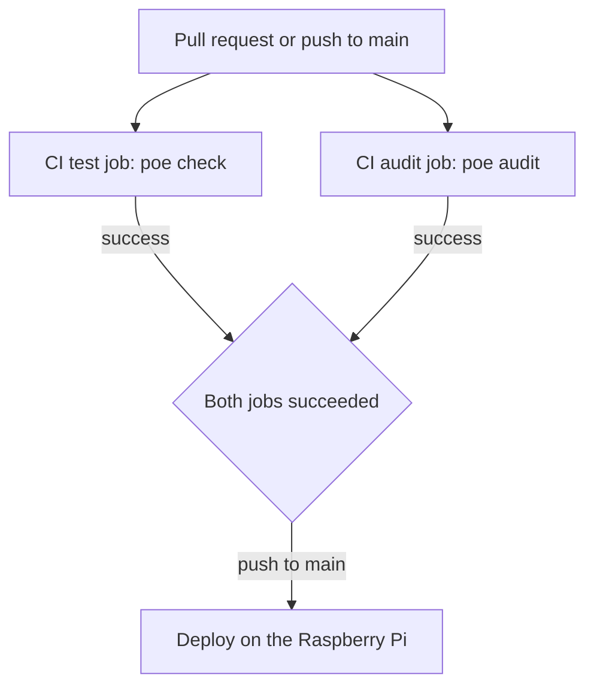

# Dependency vulnerability checks

* **Status:** Accepted
* **Date:** 2026-11-01

> **Amendment.** [Code security checks](code-security-checks.md) scans shipping source. This record still covers installed Python packages only.

## Background

CI is [`.github/workflows/ci.yml`](../../.github/workflows/ci.yml). It runs `poe check` on Python 3.12 for every pull request and for every push to `main`. [ADR 026](ADR-026.md) deploys to the Raspberry Pi only after that workflow succeeds. The image workflow builds the same application for other machines and installs it with `pip install -e .`, the same command production uses.

Those dependencies are pinned in [`pyproject.toml`](../../pyproject.toml). Nothing in CI asked whether a pinned release, or a transitive release pip selected for it, had a published vulnerability. A merge could ship a known-vulnerable library and still pass.

## Problem Statement

A known vulnerability in a library the running application imports can reach users without failing a pull request. The test suite does not detect that, and deploy treats a green CI run as fit to install.

## Objective(s)

- Fail CI when the application dependency set has a known vulnerability.
- Keep that failure in the workflow Deploy already waits on, so production does not install the vulnerable set.
- Give a local command that runs the same check.

## Scope and Deliverables

### In-Scope

- A `poe audit` task that audits the dependencies declared for the application.
- An `audit` job in the CI workflow, beside the existing test job.
- Upgrading FastAPI and pinning Starlette so the current tree has a fixed release for the findings that were already published.
- This record, and the contributing notes that tell a developer when to run the check.

### Out-of-Scope

- Auditing development-only tools (Ruff, pytest, mypy, and the rest of the `dev` extra). They are not installed by `pip install -e .`.
- The phone app. `npm audit` in `mobile/` currently reports advisories whose fix is an Expo major upgrade, and the CI workflow does not build or deploy the phone.
- A lockfile for every transitive package. Direct dependencies stay pinned; the audit resolves the tree the way pip does.
- Secret scanning, static analysis of Python, or container image scanning.
- Ignoring a finding that has a fixed release.

### Deliverables

- `pip-audit` in the `dev` extra and the `poe audit` task
- The `audit` job in `.github/workflows/ci.yml`
- FastAPI `0.162.0` and Starlette `1.10.0` in `pyproject.toml`, and the matching pins in the mypy pre-commit hook
- This record

## Technical Requirements

* **Must** audit the project dependencies in [`pyproject.toml`](../../pyproject.toml) with `pip-audit`, including the transitive packages pip resolves for them.
* **Must** run that audit in the CI workflow on pull requests and on pushes to `main`, on Python 3.12.
* **Must** fail the audit when `pip-audit` reports a known vulnerability.
* **Must** fail the audit when a dependency cannot be checked (`--strict`), so a skipped package does not count as clean.
* **Must** leave Deploy waiting on the whole CI workflow, so an audit failure blocks the Raspberry Pi update ([ADR 026](ADR-026.md)).
* **Must** keep the same command available locally as `poe audit`.
* **Must Not** put the audit inside `poe check` or the git hooks. The check needs network access to PyPI's vulnerability data, and `poe check` stays the offline test bar.
* **Must Not** pass `--ignore-vuln` for a vulnerability that has a fixed release. An exception that has no fix, or that does not apply to how Keel runs, has to be written into this record before the flag is added.
* **May** upgrade a pinned dependency in the same change when that is what clears a finding.

## Consequences

* **Good:** A pull request that introduces a known-vulnerable application dependency fails before merge, and Deploy does not install it. The same command runs locally.
* **Bad:** The audit needs PyPI. A PyPI or advisory-service outage fails the job even when the tree is unchanged. Developers who only run `poe check` will not see a new advisory until CI or `poe audit`.
* **Risk:** Transitive versions are resolved at install time, so the set CI audited and the set a later `pip install` selects can differ until those packages are pinned. The Starlette pin closes that gap for the library that had the open findings. A new advisory in an unpinned transitive package fails the next CI run rather than the already-deployed process.

## System Design

### Technical Stack and Architecture

`pip-audit` 2.10.1 reads `[project].dependencies` from `pyproject.toml` and resolves them. It does not audit the `dev` extra, and it does not audit the editable Keel package itself. The vulnerability data is PyPI's default service. The CI job installs the `dev` extra so `poe audit` is the command both places run.

FastAPI 0.116.1 required `starlette>=0.40.0,<0.48.0`. That ceiling kept Starlette 0.47.3, which had published fixes only in later releases (the highest fixed version across those findings is 1.3.1). FastAPI 0.162.0 allows `starlette>=0.46.0`, and Starlette is pinned at 1.10.0 because the application imports it directly. The custom static-file handler still overrides `StaticFiles.file_response` with the same signature that release uses.

Starlette 1.10's test client deprecates `httpx` and imports `httpx2` when it is installed. The `dev` extra therefore pins `httpx2` instead of `httpx`, so the suite uses the client that release expects.

### UML Diagrams

## Supporting Documentation

* [ADR 026](ADR-026.md)
* [CI workflow](../../.github/workflows/ci.yml)
* [Contributing](../../.github/CONTRIBUTING.md)
* [pip-audit](https://pypi.org/project/pip-audit/)
* [Code security checks](code-security-checks.md)
