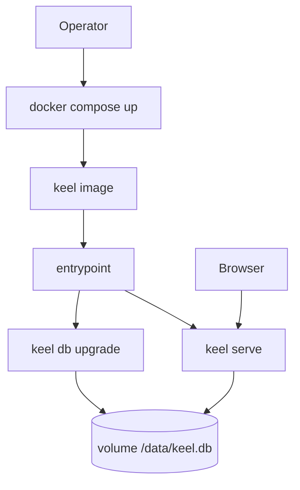
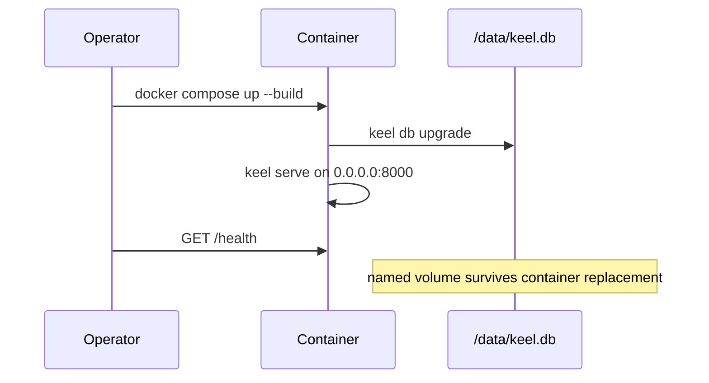

# Docker container

* **Status:** Accepted
* **Date:** 2026-10-28

## Background

Keel is one FastAPI process started with `keel serve`. Persistence is a single SQLite file, and `keel serve` refuses to start until `keel db upgrade` has brought that file up to the head revision ([ADR 007](sqlite-sqlalchemy-alembic.md)).

The owner's production host is a Raspberry Pi. That host runs `keel serve` under user systemd, with the database and env file outside the git checkout, and GitHub Actions updates it after CI on `main` ([ADR 026](ADR-026.md)). That record leaves Docker out of the Pi path on purpose: the Pi already has a deploy, and a second runtime there would split operations.

Other machines — a laptop, a spare server, a different network — have no equivalent. They would otherwise need Python 3.12, a virtualenv, a data directory, and a process manager before the same app can run.

## Problem Statement

Someone who is not on the Raspberry Pi cannot deploy Keel without reconstructing the host setup by hand. The app, its migrations, and its static assets have to travel together, the database has to survive replacement of the process, and the schema has to be current before serve starts. The Pi deploy must keep working as it does today.

## Objective(s)

- Give any environment with Docker a single command that builds and runs Keel.
- Keep the SQLite file across container replacement.
- Apply migrations before `keel serve`, using the same CLI the Pi uses.
- Leave the Raspberry Pi on systemd.

## Scope and Deliverables

### In-Scope

- A container image that installs Keel and serves it on port 8000.
- An entrypoint that runs `keel db upgrade` before `keel serve`.
- A Compose file with a named volume for the database.
- A GitHub Actions workflow that builds the image and checks `/health`, separate from the Pi deploy.
- README instructions for running, backing up, and restoring that container.

### Out-of-Scope

- Replacing or containerizing the Raspberry Pi production host.
- Publishing the image to a registry.
- TLS, a reverse proxy, or binding host port 80.
- A second database engine, or more than one container writing the same SQLite file.
- Changing sign-in, schema, or application behavior.

### Deliverables

- `Dockerfile`
- `deploy/docker-entrypoint.sh`
- `compose.yaml`
- `.dockerignore` and `.gitattributes` so the image build context and the entrypoint stay portable
- `.github/workflows/image.yml`
- This record, plus the README and the cross-links named under Supporting Documentation

## Technical Requirements

* **Must** build from `python:3.12-slim-bookworm` so the image matches Keel's Python requirement.
* **Must** install the repository in editable mode and keep `src/`, `migrations/`, `assets/`, and `LICENSE` in the image. `keel.paths` resolves migrations, assets, and the license from that tree.
* **Must** listen on `0.0.0.0` inside the container (`KEEL_HOST`) so the published port can reach the process.
* **Must** store SQLite at `/data/keel.db` (`KEEL_DATABASE_URL=sqlite+pysqlite:////data/keel.db`) on a volume mounted at `/data`.
* **Must** run `keel db upgrade` and then `keel serve` when the container starts with no command, or with a `keel serve` command. `keel serve` still refuses a stale schema.
* **Must** run any other arguments as the process command without forcing an upgrade first, so `keel db backup` and the rest of the CLI work against the same volume.
* **Must** run the process as the unprivileged user `keel`.
* **Must** expose `/health` as the image health check.
* **Must** keep `.env` out of the build context.
* **Must** build and smoke-check the image in a workflow other than [CI](../../.github/workflows/ci.yml), so an image failure does not block the Pi deploy that waits on CI ([ADR 026](ADR-026.md)).
* **Must Not** push the image to a registry.
* **Must Not** change `scripts/deploy-prod.sh`, the systemd unit, or the Pi env file.
* **Must Not** run two app containers on one database file.
* **May** bind-mount a host directory on `/data` when that directory is writable by the `keel` user.
* **May** set `KEEL_SEED_SIGN_IN=false` and `KEEL_DEFAULT_USER` for a fresh volume that should skip the built-in account.

## Consequences

* **Good:** Another machine can run Keel with Docker Compose and keep its data in a volume. Schema upgrades happen at start, with the same command production already uses. The Pi path is untouched.
* **Bad:** Each environment builds the image itself. There is no prebuilt artifact to pull. The image contains the source tree because path resolution depends on it.
* **Risk:** A bind-mounted `/data` owned by another user makes the process fail at startup. SQLite allows one writer; a second container on the same file will corrupt it. A fresh volume still receives username `keel` and password `keel` unless seed sign-in is turned off, so a published port is only safe after that password changes.

## System Design

### Technical Stack and Architecture

The image is one Python 3.12 process. Compose builds it from the repository root, publishes host port 8000, and mounts a named volume at `/data`. The entrypoint is `/usr/local/bin/keel-docker-entrypoint`. On start it upgrades, then execs `keel serve` so the server receives stop signals directly. Replacing the container keeps the volume.

The Image workflow checks out the repo, runs `docker build`, starts the image, and requests `GET /health`. It does not log in to a registry and it is not the workflow Deploy waits for.

Sign-in on an empty volume follows the existing settings. The built-in account is created when `KEEL_SEED_SIGN_IN` is left at its default. A volume that already has a person is left alone.

### UML Diagrams

## Supporting Documentation

* [ADR 007: Persistence via SQLite, SQLAlchemy, and Alembic](sqlite-sqlalchemy-alembic.md)
* [ADR 026: Automated production deploy on Raspberry Pi](ADR-026.md)
* [README](../../README.md)
* [Image workflow](../../.github/workflows/image.yml)
