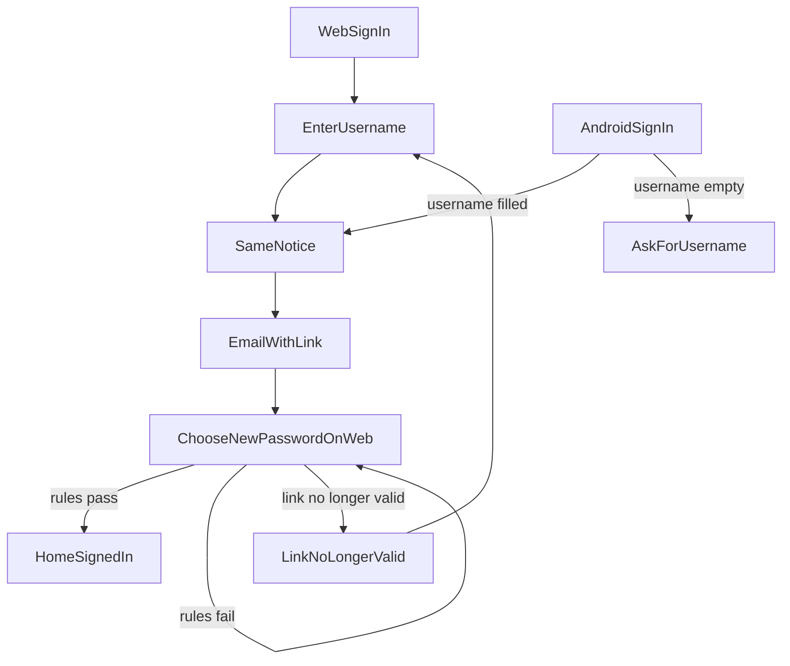
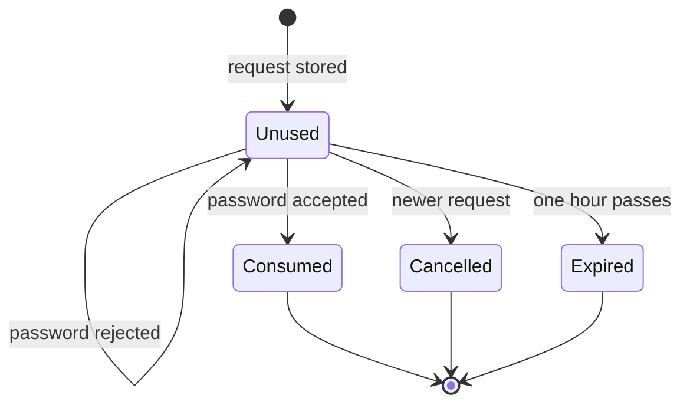

# Email password reset

* **Status:** Accepted
* **Date:** 2026-10-31

## Background

KEEL-128: a person needs to reset a forgotten password by email. Sign-in today is a username and password on the public web sign-in page, and on the Android signed-out screen (server address, username, password, sign in). The profile has an optional email that is not unique, is not a sign-in name, and is never mailed, because Keel does not send mail. Adding a person does not ask for an email, and blank clears one. Changing a password on the profile requires the current password, signs that browser in, and signs other browsers out. API tokens stay. On the server, `keel users set-password` remains the recovery path when there is no email.

[Password login](password-login.md) forbids email as a way to sign in or recover a password. [Role-based access](role-based-access.md) lists email password reset as out of scope. [User profile](../design/user-profile.md) says the address is optional and not unique. This record allows recovery by email, requires an email on every profile save and when adding a person, and makes that address unique. A profile that already has no email can still sign in. Email is still not a sign-in name. Looking up a username by email is a separate record below, delivered with this same story.

## Problem Statement

A person who has forgotten their password cannot get back in unless someone with access to the server sets a new password. The email on the profile is unused, so there is no self-serve recovery. Because the same address can sit on more than one profile, a later lookup by email would not know which username to return.

## Objective(s)

* A person who knows their username can choose a new password from a one-time link and end up signed in.
* They can start that request from the web sign-in page or the Android sign-in screen.
* Someone who does not have that email cannot tell whether a username exists, whether an email is on file, or why a link stopped working.
* Every new person has an email, and a profile cannot be saved without one. The address belongs to only one profile.
* A person whose profile already has no email can still sign in, and must add one before a reset can be sent.
* Profile password change and server `keel users set-password` keep working as they do now.

## Scope and Deliverables

### In-Scope

* A public request starting from the web sign-in page. The person enters a username.
* The same send from the Android sign-in screen, using the username already on that screen.
* One email to the address on that profile, when an address is on file. The message names the username and carries a link. It does not contain a password.
* A public web page on that link where they choose and confirm a new password. The phone opens that page from the email.
* Signing that browser in on success, and ending that person's other browser sessions.
* One page when the link is no longer valid, with a way to request another.
* Requiring an email when adding a person and when saving a profile. Blank does not clear an address.
* Uniqueness of that address, including the error a person sees when they try to save an address another profile already has.
* A person who already has no email can still sign in, and the profile asks them for one. Until they save one, a reset for that username sends nothing.

### Out-of-Scope

* Signing in with an email address, or requesting a password reset by email address.
* A native Android screen for choosing the new password.
* Replacing profile password change, or revoking API tokens.
* Choosing how mail leaves the machine, or what happens operationally when sending fails beyond the notice below.
* A second factor or single sign-on.
* Picking which existing profile keeps an address if two profiles already share one.
* The username lookup itself. That is the next record, built in the same story.

### Deliverables

* The web sign-in page offers a way to request a reset.
* The Android sign-in screen offers a way to send that same reset email.
* The request page, the choose-password page, and the invalid-link page.
* The email described above.
* Adding a person collects a required email. Saving a profile requires one and cannot clear it.
* That address can be saved on only one profile.
* This ADR, saved as `docs/adr/email-password-reset.md` after acceptance, with a short pointer from the recovery clause in [Password login](password-login.md), from the out-of-scope bullet in [Role-based access](role-based-access.md), and from the lines in [User profile](../design/user-profile.md) that call the address optional and not unique.

## Technical Requirements

* **Must** let a person open the request from the web sign-in page and submit a username. Matching is case-insensitive, as sign-in already is.
* **Must** put a control on the Android sign-in screen that sends the reset for the username in that screen's username field. If the field is empty, the screen tells them to enter a username and does not claim a message was sent.
* **Must** show the same notice for every completed submit, on the web and on Android: if that username has an email on file, a reset link was sent. The notice must not say whether the username exists, whether an email is on file, or whether a message was actually handed off.
* **Must** send the link only to the email stored on that username's profile. A profile that still has no email sends nothing, and the public notice stays the same.
* **Must** collect an email when adding a person, and require one when saving a profile. An empty value is refused. Saving cannot clear an address.
* **Must** let a person who already has no email sign in. Their profile must get an email on the next save. Until then, a reset for that username sends nothing.
* **Must** keep each email on at most one profile. Comparison is case-insensitive, so `Name@example.com` and `name@example.com` are the same address.
* **Must** refuse a profile save that takes an address another profile already has, and tell that person the address is already used. That refusal is the one place this story says an address is taken. The public reset notice must not.
* **Must** keep the link good for one hour. A newer request for that username cancels the previous unused link.
* **Must** show a form for a new password and a confirmation on the web page the link opens. Opening the link, or submitting a password that fails the rules, must not use the link up.
* **Must** apply the same password rules as a profile change: 12 to 128 characters, not the username, not the current password, and both fields must match. Failures stay on the form with the same kinds of messages the profile already uses.
* **Must** on a valid new password, replace the password, use up the link, sign this browser in as that person, and end their other browser sessions. API tokens stay. They land on the home page, the same place a sign-in with no return address lands.
* **Must** show one invalid-link page for an expired link, a cancelled link, an already-used link, or a link that does not exist. The page must not say which of those it is, and it must offer a way to request a new link.
* **May** keep the new pages visually in line with the existing sign-in page, and the Android control in line with the signed-out screen.
* **Must Not** reveal the stored email address on the request page, in the notice, on the Android screen, or on the invalid-link page.
* **Must Not** accept an email address as the thing they type to request a password reset.
* **Must Not** put a password, temporary or otherwise, in the email.
* **Must Not** leave them signed out after a successful reset, and must not leave other browser sessions signed in.
* **Must Not** revoke API tokens, change the profile "current password" flow, or add a native screen for choosing the new password.

## Consequences

* **Good:** A person with an email on file can get back in from the web or the Android sign-in screen, without someone at the server. New profiles always have an address. A later lookup by email has only one username to find.
* **Bad:** Whoever can read that inbox can set the password during the hour the link is good. An email cannot be cleared, and two profiles can no longer share an address. A person who already has no email and has also forgotten their password still needs someone at the server. If they still know the password, they sign in and must add an email on the profile. The public notice still does not say that the address is missing.
* **Risk:** The person may only notice a takeover because their other browsers were signed out. API tokens keep working through a reset. If two profiles already share an address, this record does not choose which one keeps it.

## System Design

### Technical Stack and Architecture

The feature adds a request path on the existing public web sign-in page, the same send from the Android signed-out screen, and two public web pages: ask for a link, and choose a new password from that link. The phone opens the choose-password page from the email; it does not grow a native password form. The Android app already signs in by asking the server, so that screen has to be able to ask the server to send the reset as well. The message goes to the email already stored on the profile. After success the browser is signed in and lands on the home page. Profile password change, the people-admin screens, and `keel users set-password` stay as they are. A message is handed to a separate SMTP service when `KEEL_SMTP_HOST` and `KEEL_SMTP_FROM` are set. Keel does not run that service. If they are unset, or the handoff fails, the person still sees the same notice and no message goes out.

### UML Diagrams

Consumed, cancelled, and expired all look the same to the person who opens the link.

## Supporting Documentation

* [Password login](password-login.md)
* [User profile](../design/user-profile.md)
* [Role-based access](role-based-access.md)

## Assumptions

* Choosing the new password stays on the web page, including when the email is opened on the phone. Android only sends the reset.
* The web pages follow the sign-in page: a submit replaces the page. There is no separate loading screen.
* The email names the username and contains only the link.
* A failed password check does not consume the link. Only a successful change does.
* Repeating a request is allowed and always shows the same notice. There is no separate "try again later" message.
* The request and reset pages work even if this browser is already signed in. Success signs this browser in as the person whose password changed.
* A profile that already has no email can still sign in. The next profile save must include an email. Reset sends nothing for that username until then.
* If stored profiles already share an address, this outline does not pick a winner. Both cannot keep it.
