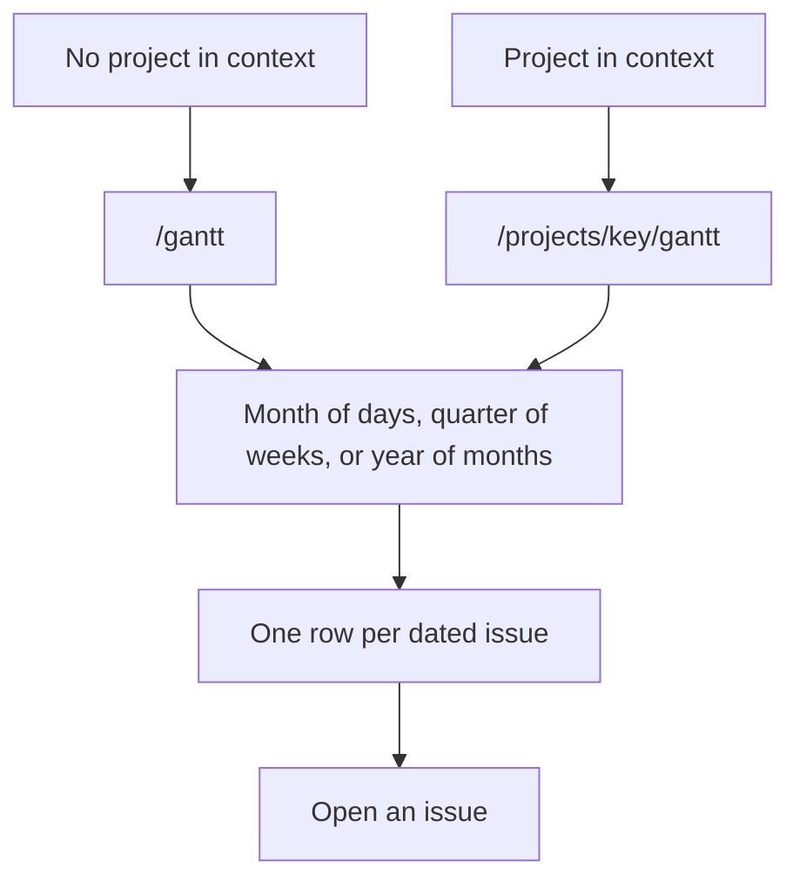
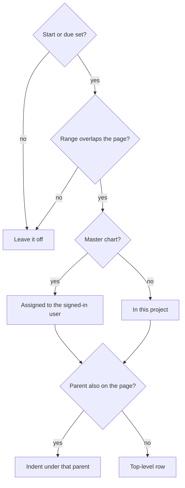

# Gantt chart

* **Status:** Accepted
* **Date:** 2026-10-31

## Background

The calendar lays dated work on the days it covers ([Calendar of assigned work](month-calendar.md)). Issues already store an optional start and an optional due ([ADR 029](ADR-029.md)). That chart answers which days are occupied. It does not line the issues up so their lengths can be compared, and it does not keep a child under its parent.

## Problem Statement

Planning a stretch of work from the calendar means reading bars inside day cells. There is no page where each issue is a row and time runs left to right, so overlap and duration are hard to see at once, and a story does not sit under its epic.

## Objective(s)

- Open a month and see one row per dated issue, with a bar from the start day through the due day.
- Open the quarter that contains that month, with one column per week.
- Open the year that contains that month, with one column per month.
- On `/gantt`, limit that set to issues assigned to the signed-in user, across projects. Done and Cancelled stay in the set. The status filter is what removes them.
- Inside a project, open that project's chart and see its dated issues, whoever they are assigned to, including Done and Cancelled.
- Move to the previous month, quarter, or year, the next one, a month and year chosen from dropdowns, and back to the current month, quarter, or year without leaving that scale.
- Open an issue from its row or its bar.
- Keep a child under its parent when the parent is also a row on the page.
- See a blocks link as an arrow from the blocking issue to the one it blocks, and a relates-to link as a dashed line, when both issues are rows on the page.

## Scope and Deliverables

### In-Scope

- A Gantt link in the top bar. It opens `/gantt` when the page has no current project, and `/projects/{key}/gantt` when it does.
- One month of days, with Previous, Next, and Today. Those links stay on the month scale.
- One calendar quarter, reached from a Quarter control on the same page. Previous and Next step three months and stay on the quarter scale. Columns are Monday–Sunday weeks. A bar fills every week it touches.
- One calendar year, reached from a Year control on the same page. Previous and Next step twelve months and stay on the year scale. Columns are the twelve months. A bar fills every month it touches.
- On `/gantt`, issues assigned to the acting user, in any project, including Done and Cancelled, when the issue has a start, a due date, or both, and that range overlaps the page.
- On `/projects/{key}/gantt`, dated issues in that project, whoever they are assigned to, including Done and Cancelled, on the same rule.
- A bar from the start day through the due day, inclusive. One date is a one-day mark on the month scale, one week column on the quarter scale, and one month column on the year scale. A bar that runs past the page is clipped, and the clipped end is marked.
- The issue key, title, and a status mark on the row, linking to the issue. The bar links to the same issue. The project key is not repeated in front of the issue key. The bar uses the epic, story, and subtask hues from a board card.
- A child indented under its parent when that parent is also on the page. Otherwise the issue is a row of its own. Rows at the same level run from the earlier start.
- The shared filter bar. It only narrows which of those issues appear. Reset all leaves the month, quarter, or year as it is.
- The same page on a phone-narrow window: the chart scrolls sideways and the issue name stays put.
- A blocks arrow and a relates-to line for a dependency whose two issues are both rows. The arrow runs from the end of the blocking bar toward the start of the blocked bar. The relates-to line joins the middles and has no arrow. A short note names the two marks. Each link is also written as text.

### Out-of-Scope

- Dragging a bar to change dates.
- Editing dates on this page.
- Adding or removing a dependency from this page.
- Drawing a dependency whose other issue is not a row on the page.
- Rolling a child's dates up onto the parent.
- Completed and Created on. The calendar already places those.
- The phone app. The phone browser uses this page.
- A saved zoom other than month, quarter, and year.

### Deliverables

- This ADR as the behavior source of truth for the gantt pages.
- `/gantt`, `/projects/{key}/gantt`, and the Gantt link.
- View gantt in the permission catalog, held by the same project roles that can view the calendar. Route checks wait with the other project pages (KEEL-105).

## Technical Requirements

* **Must** add Gantt to the top bar. It **Must** link to `/gantt` when the page has no current project, and to `/projects/{key}/gantt` when it has one.
* **Must** show one month as one column per day. Previous and Next **Must** move by `?month=YYYY-MM` on the month scale. Month and Year dropdowns **Must** jump to that month on the same scale, including when JavaScript has not run. Today **Must** return to the month that contains the server's local today. A missing or unusable month **Must** be that same current month.
* **Must** offer Month, Quarter, and Year on both gantt pages. Choosing one **Must** stay on the master chart or the project chart that is already open.
* **Must** show one calendar quarter: January–March, April–June, July–September, or October–December. Previous and Next **Must** move three months by `?view=quarter&month=YYYY-MM` and stay on the quarter scale. Today **Must** return to the quarter that contains the server's local today. A missing or unusable month **Must** be the quarter that contains today. The heading **Must** name the first month and the last month.
* **Must**, on the quarter scale, use one column per Monday–Sunday week from the week that contains the first day through the week that contains the last day. A bar **Must** occupy every week its range overlaps. Month and Year dropdowns **Must** jump to the quarter that contains the chosen month and stay on the quarter scale.
* **Must** show one calendar year, January through December. Previous and Next **Must** move twelve months by `?view=year&month=YYYY-01` and stay on the year scale. Today **Must** return to the year that contains the server's local today. A missing or unusable month **Must** be the year that contains today. The heading **Must** name the year.
* **Must**, on the year scale, use one column per month. A bar **Must** occupy every month its range overlaps. Month and Year dropdowns **Must** jump to the year that contains the chosen month and stay on the year scale.
* **Must**, from the month scale, open Quarter on the quarter that contains the shown month, and Year on the year that contains the shown month. From the quarter scale, Month **Must** open the month of the server's local today when today falls in the shown quarter, and otherwise the first month of that quarter. From the year scale, Month **Must** open the month of the server's local today when today falls in the shown year, and otherwise January of that year. Quarter **Must** open the quarter that contains today when today falls in the shown year, and otherwise January–March of that year.
* **Must**, on `/gantt`, include an issue assigned to the acting user when it has a start, a due date, or both, and that range overlaps the page. Done and Cancelled **Must** be included. The status filter is what leaves them off.
* **Must**, on `/projects/{key}/gantt`, include an issue in that project when it has a start, a due date, or both, and that range overlaps the page, whoever it is assigned to, including Done and Cancelled. Issues from other projects **Must** stay off that page.
* **Must** use the calendar date, the same way Home and the calendar do.
* **Must** draw one bar from the start day through the due day, inclusive. When only one of those dates is set, the bar **Must** be that day. On the month scale a one-day issue **Must** be a single-day mark. A bar that begins or ends outside the page **Must** be clipped, and that clipped end **Must** be marked.
* **Must** show the issue key, title, and status on the row, and link the row and the bar to the issue. **Must Not** repeat the project key in front of the issue key. **Must** color the bar by issue type with the same epic, story, and subtask hues as a board card.
* **Must** list a child under its parent, indented one step, when that parent is also a row. An issue whose parent is not on the page **Must** be a top-level row. Rows that share a parent **Must** run from the earlier start day, then the earlier due day, then the issue key. A parent **Must** come before its children even when a child starts earlier.
* **Must** highlight the day column, the week column, or the month column that contains the server's local today when today is on the page.
* **Must**, when a *blocks* link joins two issues that are both rows, draw an arrow from the end of the blocking bar toward the start of the blocked bar. **Must**, when a *relates-to* link joins two such issues, draw a dashed line between the middles of those bars and **Must Not** give that line an arrow. **Must** write each link as text, and **Must** say which mark is which. **Must Not** draw a link whose other issue is not a row. **Must Not** add or remove a dependency from either page.
* **Must** show the shared filter bar ([Common filtering](common-filtering.md)). On a project chart it **Must** hide the project filter. Reset all **Must** clear filters and leave the month, quarter, or year as it is. Previous, Next, Today, and the date dropdowns **Must** keep the filters.
* **Must** still show the column headings when nothing dated falls on the page, with a short note that nothing falls in the month, the quarter, or the year.
* **Must** work without JavaScript and on the existing phone-narrow layout ([ADR 018](phone-layout.md)). On a narrow window the chart **Must** scroll sideways and the issue name **Must** stay visible.
* **Must Not**, on `/gantt`, include an issue with neither date, an unassigned issue, or an issue assigned to someone else. **Must Not** drop a Done or Cancelled issue before the status filter runs.
* **Must Not**, on a project chart, include an issue with neither date, or an issue from another project. **Must Not** drop a Done or Cancelled issue before the status filter runs.
* **Must Not** change start, due, parent, status, or dependencies from either page.

## Consequences

* **Good:** A person can compare how long each piece of dated work runs, see a child under its parent, and see which of those rows block or relate to each other.
* **Bad:** Opening an issue from the master chart makes Gantt the project chart. Getting back to `/gantt` means leaving the project first. The calendar already works this way.
* **Bad:** On the quarter scale a one-day issue fills a week column, so a short issue looks as wide as a week that it only touches. On the year scale it fills a month column.
* **Bad:** A dependency whose other issue is off the page leaves no mark, so the chart can look quieter than the issue page.
* **Risk:** "Today" follows the server's local date, the same accepted risk as Home. A host in another timezone can disagree with the wall calendar used when the date was entered.

## System Design

### Technical Stack and Architecture

This is two pages on the existing server-rendered chrome, the same split as the master calendar and a project calendar. Gantt sits in the top bar beside Calendar. With no project in context it opens `/gantt`. With a project in context it opens that project's chart. The bars are computed from issues already stored, using the same calendar-day reading as the home inbox. Choosing a row or a bar opens the existing issue page. A dependency already stored between two of those rows is drawn on the chart: *blocks* as an arrow from the blocking bar toward the blocked bar, *relates-to* as a dashed line. The line is omitted when the other issue is not a row. No new table and no JSON route. View gantt is another project permission beside View calendar. The catalog is seeded on startup. The page itself is not refused until the project route checks in KEEL-105.

### UML Diagrams

## Supporting Documentation

* [ADR 006](ticket-dependencies.md)
* [Calendar of assigned work](month-calendar.md)
* [ADR 029](ADR-029.md)
* [Common filtering](common-filtering.md)
* [UI design](../design/ui.md)
* [RBAC catalog](../design/rbac-catalog.md)
