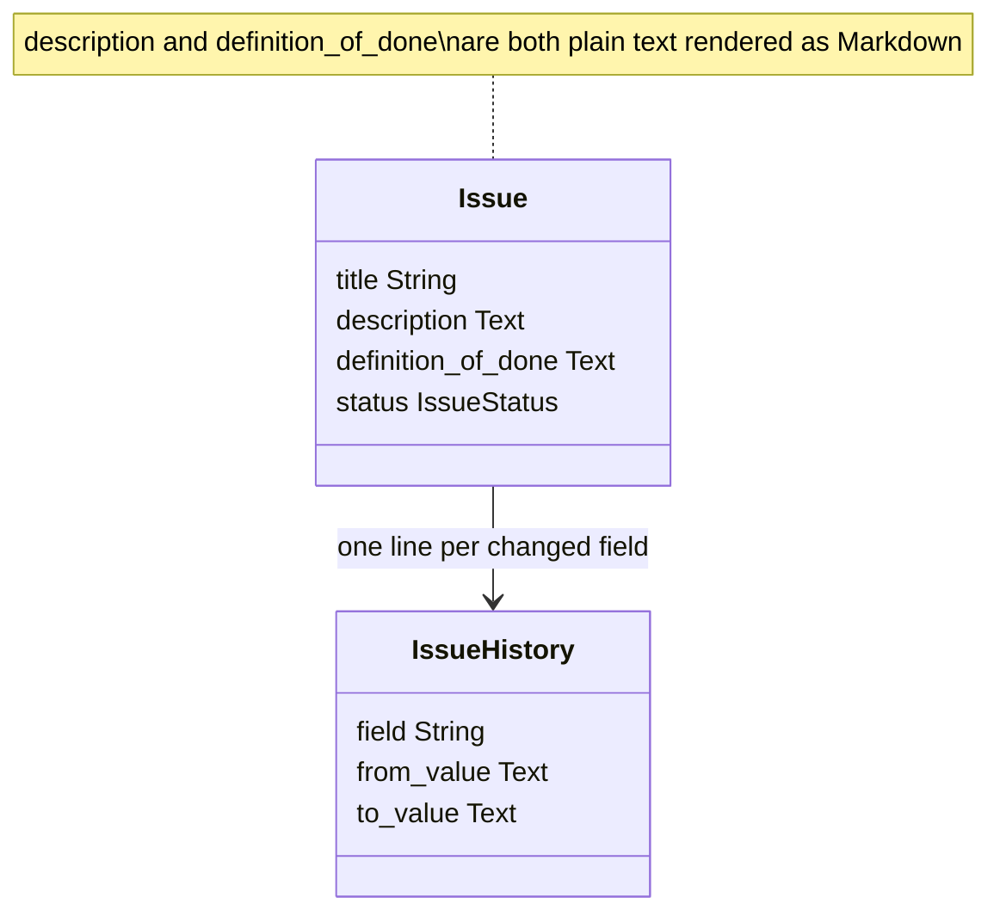
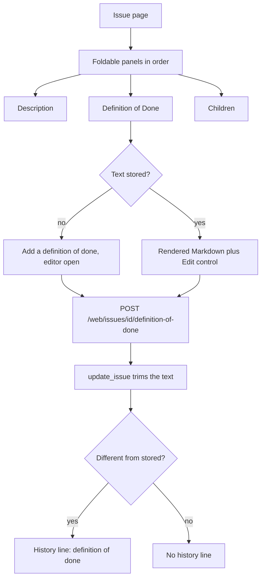

# Issue definition of done

* **Status:** Accepted
* **Date:** 2026-10-28

## Background

An issue carries one free-text body: `description`, stored as plain text and rendered as Markdown on the issue page ([ADR 017](markdown-descriptions-and-comments.md)). Statuses are shared by every project and the workflow is fixed ([ADR 004](shared-fixed-workflow.md)), so *Done* means the same thing everywhere and nothing on the issue says what *Done* means for that particular piece of work. KEEL-112 asks for a second body for exactly that, sitting directly beneath Description.

## Problem Statement

Acceptance criteria end up buried in the description, in a comment, or in someone's head. A reader cannot tell at a glance what has to be true before the issue may move to *Done*, and a writer has no obvious place to put it. Comments are a thread, not a field: the criteria scroll away and have no stable home.

## Objective(s)

- Give every issue one named place for its *Done* criteria.
- Make that field behave like Description, so nothing new has to be learned: free text, Markdown, inline edit, history, search.
- Place it directly beneath Description on the issue page and on Create.

## Scope and Deliverables

### In-Scope

* A `definition_of_done` text attribute on Issue, default empty, never null.
* Its own foldable panel on the issue page titled **Definition of Done**, immediately after Description and before Children.
* Inline edit on that panel, autosubmitting like Description with a Save fallback.
* A field on the Create form, directly beneath Description.
* Create, read, and update through the JSON issue API.
* A `definition of done` line in the per-issue history ([ADR 025](ADR-025.md)).
* Find matches on the text, with a snippet when the key and title do not match ([ADR 016](find-from-the-top-bar.md)).
* Read, create, and edit in the Android shell ([Android app shell](android-app-shell.md)), including the offline queue.

### Out-of-Scope

* Making it required, or blocking a move to *Done* on it. Nothing validates the text.
* Checklist semantics. Markdown task syntax renders as Markdown does; Keel does not count or tick boxes.
* A definition of done on the series recipe, so spawned copies would inherit one. Type, title, description, priority, and labels each arrived on the recipe as their own change ([Series recipe priority](series-recipe-priority.md), [Series recipe labels](series-recipe-labels.md)); this one follows the same route later.
* Inheriting a parent's or project's criteria. There is no default and no template.
* A board card, list column, or filter for the field.
* Quoting the text in the request log, the same as Description ([Log tracker](log-tracker.md)).

### Deliverables

* This ADR as the behavior source of truth.
* The Issue column, an Alembic revision, service and schema wiring, the issue-page panel, the Create field, and the `/web` route.
* Android shell parity.
* Updates to the data model, API reference, UI design, domain model, capabilities, use cases, glossary, and v1 scope.

## Technical Requirements

* **Must** store `definition_of_done` as `TEXT`, not null, defaulting to the empty string, and **Must** backfill existing issues to empty.
* **Must** strip leading and trailing whitespace on create and update, matching Description.
* **Must** treat empty as "not set": the panel renders no Markdown block and offers *Add a definition of done* instead of *Edit definition of done*.
* **Must** render the stored text as Markdown and keep the source in the panel's edit control, so it still works without JavaScript ([ADR 017](markdown-descriptions-and-comments.md)).
* **Must** place the panel directly after Description and before Children, and **Must** make it foldable on the same `keel_issue_panels` cookie under the key `definition_of_done` ([Foldable issue panels](foldable-issue-panels.md)).
* **Must Not** give the panel a row count; it holds one body, not a list.
* **Must** accept `definition_of_done` on the issue create and patch bodies, and **Must** return it on every issue read. An absent PATCH key leaves the stored text alone.
* **Must** record a history line under the field name `definition of done` when the trimmed text changes, using the same *none* placeholder as Description for an empty side. **Must Not** record a line when the save is a no-op.
* **Must** widen the `issue_history.field` `CHECK` constraint to allow that name, and **Must** keep it within the column's 20-character limit.
* **Must** name the field in a request-log note without quoting the body, the same as Description.
* **Must** search the text in Find and **Must** fall back to a Description snippet first, then this field, then comments, so one hit does not change what an existing query returns.
* **Must Not** require the field, derive a status from it, or refuse a move to *Done* when it is empty.
* **Must Not** add a second body to the series recipe in this change.

## Consequences

* **Good:** Acceptance criteria get a stable home, and *Done* becomes checkable per issue without changing the shared workflow.
* **Good:** Nothing new to learn. The field is Description's twin in storage, rendering, editing, history, and search, so the existing Markdown and panel machinery carries it.
* **Bad:** The issue page grows another panel, which lengthens the scroll for issues that will never use the field. Folding is the mitigation, and an empty panel stays one line plus its edit control.
* **Bad:** A repeating job has to restate its criteria on every copy until the recipe gains the field.
* **Risk:** Two free-text bodies invite the question of which one a note belongs in, and criteria already written into descriptions are not migrated. Accepted: nothing breaks, and the old text stays where it is until someone moves it.
* **Risk:** Find now matches text that used to be invisible to it, so a query can return more issues than before. Accepted; it is the same contract Description already has.

## System Design

### Technical Stack and Architecture

No new machinery. The Issue ORM column, the `IssueCreate` / `IssueUpdate` / `IssueRead` schemas, `create_issue` and `update_issue`, the JSON routes, and the `/web` forms carry one more string. `update_issue` reuses `history_service.text_label`, so an empty side reads *none* exactly as Description does. The issue page gains one `issue_panel` call and one `POST /web/issues/{issue_id}/definition-of-done` route that differs from the description route only in the field it sets. `issue_panels.PANELS` gains the key, which is what fixes the order and the fold cookie. Find adds one `ilike` to the issue `or_` and one snippet fallback. The request-log history note moves from a single description special case to a small set of long-text fields that are named but never quoted.

### UML Diagrams

## Supporting Documentation

* [ADR 017: Render issue descriptions and comments as Markdown](markdown-descriptions-and-comments.md)
* [ADR 025: Lightweight per-issue field history](ADR-025.md)
* [ADR 004: Shared fixed workflow with a small status set](shared-fixed-workflow.md)
* [ADR 016: Find from the top bar by name](find-from-the-top-bar.md)
* [Foldable issue panels](foldable-issue-panels.md)
* [Data model](../design/data-model.md)
* [API reference](../design/api.md)
* [UI design](../design/ui.md)
* [Domain model](../architecture/domain-model.md)
* [Capabilities](../architecture/capabilities.md)
* [Use cases](../architecture/use-cases.md)
* [Glossary](../architecture/glossary.md)
