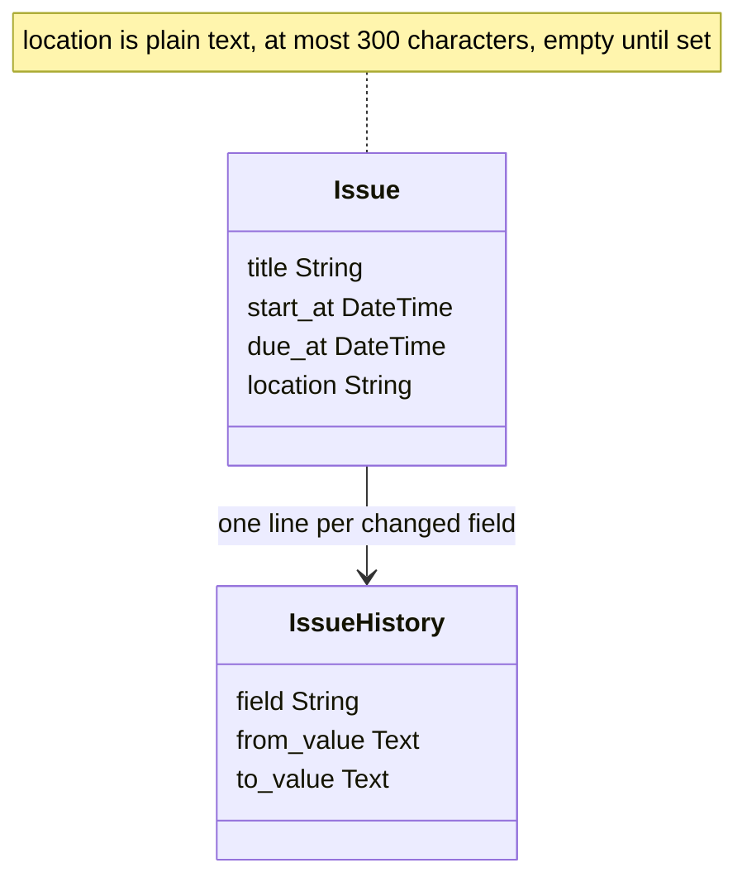
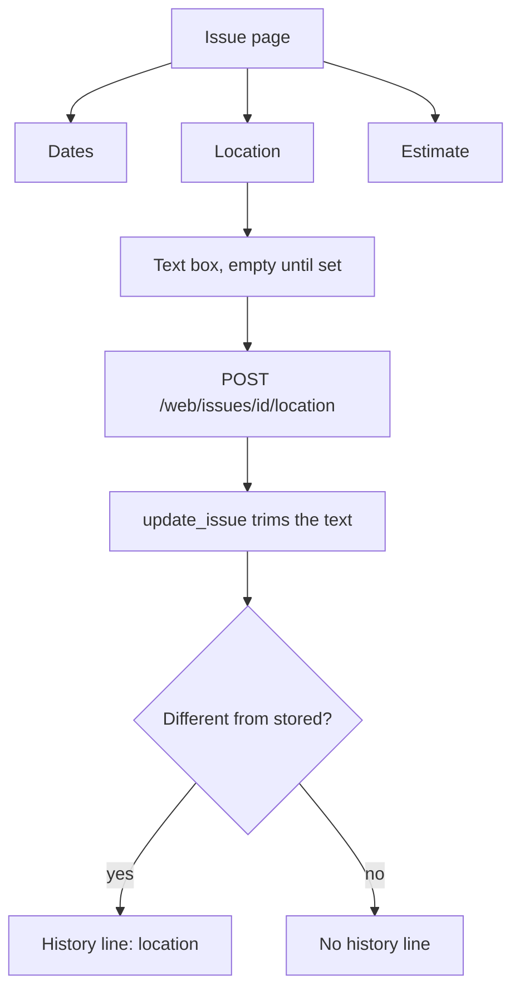

# Issue location

* **Status:** Accepted
* **Date:** 2026-11-02

## Background

An issue already records when work happens (`start_at`, `due_at`) and what it is (title, description, definition of done). KEEL-116 asks for where it happens: a house chore in the shed, a boat job at the marina, a software task at a desk. The place is occasional. Most issues never need one.

## Problem Statement

Where a piece of work will take place lives in the title, the description, or someone's memory. A reader cannot scan for the place, and a later edit of the description can bury it. There is no field whose only job is the place.

## Objective(s)

- Give every issue one optional place name.
- Leave it blank until someone sets it.
- Let the website and the phone app show it and change it, and let Find reach it.

## Scope and Deliverables

### In-Scope

* A `location` string on Issue, default empty, never null, at most 300 characters.
* A Location fact on the issue page, directly after Dates, editing in place.
* A Location field on Create, in Dates and effort.
* Create, read, and update through the JSON issue API.
* A `location` line in the per-issue history ([ADR 025](ADR-025.md)).
* Find matches on the text, with a snippet only when the key, title, description, and definition of done do not already explain the hit ([ADR 016](find-from-the-top-bar.md)).
* Read, create, and edit in the Android shell ([Android app shell](android-app-shell.md)), including the offline queue and conflict list.

### Out-of-Scope

* Making it required, or checking that the text is a real address.
* A map, coordinates, or a catalog of places.
* A location on the series recipe, so spawned copies would inherit one.
* A board card, backlog column, calendar label, or filter for the field.
* Markdown rendering. The text is shown as typed.

### Deliverables

* This ADR as the behavior source of truth.
* The Issue column, an Alembic revision, service and schema wiring, the issue-page fact, the Create field, and the `/web` route.
* Android shell parity.
* Updates to the data model, API reference, UI design, domain model, capabilities, use cases, glossary, and v1 scope.

## Technical Requirements

* **Must** store `location` as a string of at most 300 characters, not null, defaulting to the empty string, and **Must** backfill existing issues to empty.
* **Must** strip leading and trailing whitespace on create and update, and **Must** keep at most 300 characters after that strip.
* **Must** treat empty as "not set": the issue page shows an empty box with the placeholder *Where will this happen?*, and the phone's read-only line says *None*.
* **Must** place the fact directly after Dates and before Estimate, spanning the facts row, and **Must** autosubmit it the same way the other facts do, with a Save button when JavaScript has not run.
* **Must** accept `location` on the issue create and patch bodies, and **Must** return it on every issue read. An absent PATCH key leaves the stored text alone. A create that omits it stores empty.
* **Must** record a history line under the field name `location` when the trimmed text changes, using the same *none* placeholder as Description for an empty side. **Must Not** record a line when the save is a no-op.
* **Must** widen the `issue_history.field` `CHECK` constraint to allow that name. The name fits the column's 20-character limit.
* **Must** quote the text in the request-log note, the same as a title change, because a place name is short.
* **Must** search the text in Find. A snippet comes from description first, then definition of done, then location, then comments.
* **Must Not** require the field, and **Must Not** add it to the series recipe in this change.

## Consequences

* **Good:** A place has a stable home next to the dates, and Find can reach an issue by where it happens.
* **Good:** Existing issues stay valid. The field arrives empty and nothing else on the issue changes.
* **Bad:** The issue page and Create grow one more box that most issues will leave blank.
* **Bad:** A repeating job has to restate its place on every copy until the recipe gains the field.
* **Risk:** People will write addresses, room names, and "online" into the same box. Accepted: it is one free string, not a structured place.

## System Design

### Technical Stack and Architecture

No new machinery. The Issue ORM column, the `IssueCreate` / `IssueUpdate` / `IssueRead` schemas, `create_issue` and `update_issue`, the JSON routes, and the `/web` forms carry one more string. `update_issue` reuses `history_service.text_label`, so an empty side reads *none*. The issue page gains one fact and one `POST /web/issues/{issue_id}/location` route. Find adds one `ilike` and one snippet fallback after definition of done. The phone stores the string on the local issue, shows it under Due, and sends it only when it differs from what is already stored.

### UML Diagrams

## Supporting Documentation

* [ADR 025: Lightweight per-issue field history](ADR-025.md)
* [ADR 016: Find from the top bar by name](find-from-the-top-bar.md)
* [ADR 029: Optional start and due](ADR-029.md)
* [Android app shell](android-app-shell.md)
* [Data model](../design/data-model.md)
* [API reference](../design/api.md)
* [UI design](../design/ui.md)
* [Domain model](../architecture/domain-model.md)
* [Capabilities](../architecture/capabilities.md)
* [Use cases](../architecture/use-cases.md)
* [Glossary](../architecture/glossary.md)
