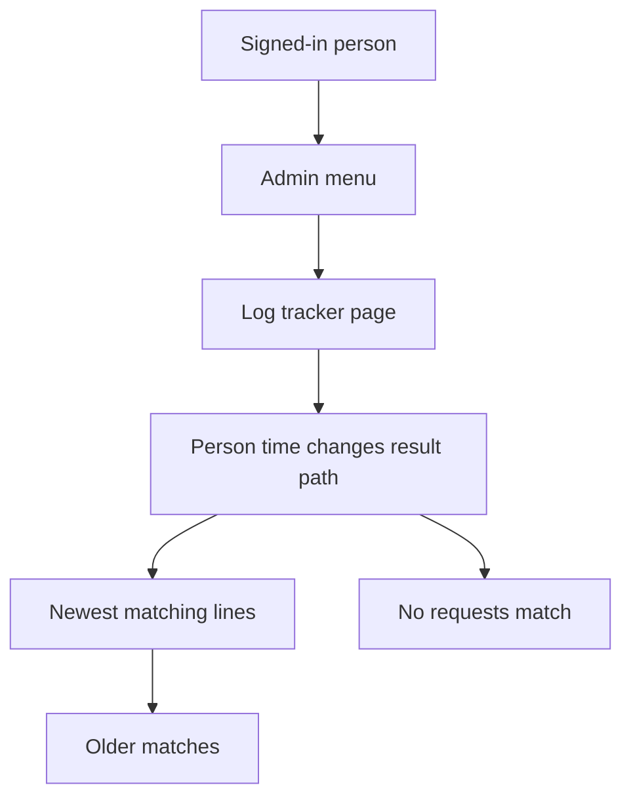
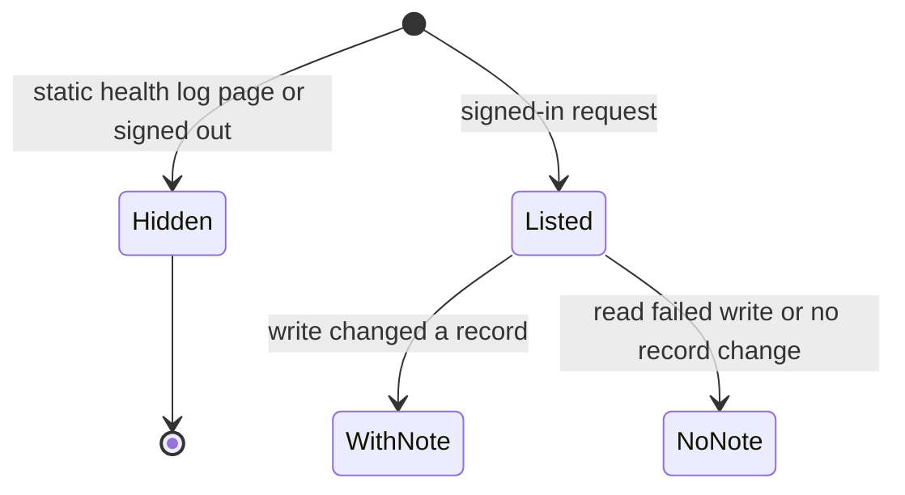

# Log tracker

* **Status:** Accepted
* **Date:** 2026-10-14

## Background

KEEL-70 asks for a log of every request so a person can see what someone did and sort out their issues. Keel has no admin role: every signed-in person can do the same things ([Password login](password-login.md)). Role-based access is a later update.

The top bar already has a Help menu on the right ([Persistent top menu bar](persistent-top-menu-bar.md)). Each issue already has a History panel of field changes. This feature is a separate request log. Server settings are `KEEL_` environment variables and an optional `.env` file.

## Problem Statement

There is no place to see which requests a person made. When something goes wrong, the issue History panel shows field changes on that issue only. It does not show the rest of what they did, failed attempts, or requests that never became a field change.

## Objective(s)

- Let any signed-in person open a log of requests and see who did what, when.
- Let them narrow that log to one person, a time range, writes, successes or failures, and a path.
- Show a short note when a write changed a Keel record.
- Drop old log entries by age and by the log’s own storage, with defaults a new server can live with.

## Scope and Deliverables

### In-Scope

* An Admin menu on the right side of the top bar, immediately left of Help, with one item: Log tracker.
* A Log tracker page listing signed-in requests, newest first, with a way to move to older matches.
* Filters: person (one person or everyone), time (from/to, with shortcuts for today, 7 days, and 30 days), all requests vs changes only, result (all / succeeded / failed), and path contains.
* A change note when a write changed a Keel record.
* Retention: 30 days and 100 MB by default, oldest entries first, either limit turn-off-able, configured with the existing `KEEL_` / `.env` settings. The limit is the log’s own stored data.

### Out-of-Scope

* Roles or hiding the log from some signed-in people. That waits for role-based access.
* Request bodies, query strings, passwords, session cookies, and API tokens.
* Signed-out traffic, including the login page and failed logins.
* Static files, the favicon, `GET /health`, and the Log tracker page’s own requests.
* A JSON API for reading the log. API requests are still recorded.
* Editing retention on the page.
* Changing the issue History panel.

### Deliverables

* This record.
* The Admin menu, the Log tracker page, filters, change notes, and retention behavior.

## Technical Requirements

* **Must** show the Admin menu to every signed-in person, in the right side of the top bar, immediately left of Help. The menu contains Log tracker, which opens the log page.
* **Must** list requests made by a signed-in person, newest first, one page at a time, with a way to open older matches.
* **Must** show who, when, method, path, and response status on each line.
* **Must** add a short plain-language note only when a write changed a Keel record, naming the record and what changed (for example `KEEL-70 status To Do → In Progress`).
* **Must** leave the change note off when a write failed or changed no record. Those lines still show method, path, and status.
* **Must** treat POST, PATCH, PUT, and DELETE as changes, including failures. Other methods appear when the list is showing all requests.
* **Must** treat 2xx and 3xx as succeeded, and 4xx and 5xx as failed. Keel form posts often redirect on success.
* **Must** filter by person, from/to time (shortcuts: today, 7 days, 30 days), all vs changes only, result, and path contains. Filters combine.
* **Must** show an empty state when nothing matches, including a log that has no entries yet.
* **Must** send a signed-out visitor to login, the same way other pages do.
* **Must** keep passwords, session cookies, API tokens, query strings, and bodies out of what is stored and what is shown.
* **Must** omit static files, the favicon, `GET /health`, and requests that only render the Log tracker page.
* **Must** drop the oldest entries when they are older than 30 days or the log’s own storage is over 100 MB, whichever is reached first. Either limit can be turned off in `KEEL_` settings or `.env`.
* **May** show the active filters on the page so a person can see why the list is short.
* **Must Not** add a role, an admin-only gate, or a retention form on the page.
* **Must Not** record signed-out requests.
* **Must Not** change the issue History panel.

## Consequences

* **Good:** Anyone signed in can see what a person requested and which writes failed, without opening each issue.
* **Bad:** The log grows with ordinary use until the age or size limit removes the oldest lines. People who expected a permanent audit trail will see older lines disappear.
* **Risk:** A write the note cannot describe still appears as method, path, and status, so some lines say less than “what they did.” Role-based access is not here; every signed-in person can read the full log until that later update.

## System Design

### Technical Stack and Architecture

The same server-rendered pages and the same sign-in gate. The new entry point is an Admin menu beside Help in the top bar. The Log tracker is a new page in that shell. The issue page History panel stays the field-change list it already is. Retention uses the existing settings mechanism (`KEEL_` environment variables and `.env`).

### UML Diagrams

## Supporting Documentation

* [Password login](password-login.md)
* [Persistent top menu bar](persistent-top-menu-bar.md)
