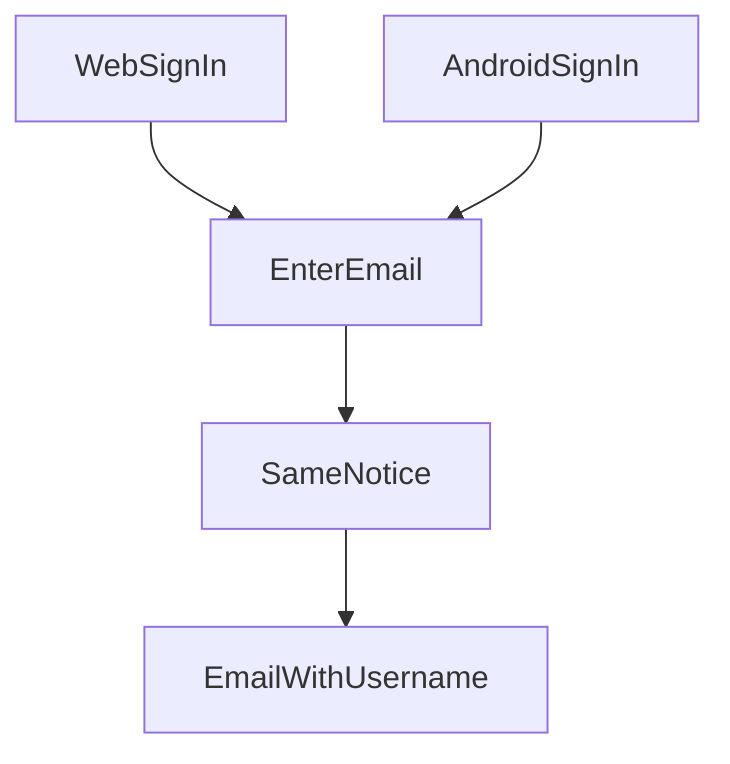

# Lookup username by email

* **Status:** Accepted
* **Date:** 2026-10-31

## Background

Sign-in and password reset both ask for a username. A person who remembers the email on their profile, and not the username, cannot learn it. [Email password reset](email-password-reset.md) requires an email on every new person and every profile save, and that address belongs to one profile, so an address matches at most one username. A profile that already has no email is not a match until that person adds one. Keel still does not send mail. This record is separate from password reset and is delivered with KEEL-128, not as its own story.

## Problem Statement

Forgetting the username blocks both sign-in and the password reset, because each one starts from the username. There is no way to recover that name from the email on the profile.

## Objective(s)

* A signed-out person who knows the email can have the username sent to that address.
* The screen does not reveal whether any profile has that address.

## Scope and Deliverables

### In-Scope

* A public request from the web sign-in page. The person enters an email address.
* The same request from the Android sign-in screen.
* One email to that address when a profile has it. The message contains the username.
* The same notice whether or not a profile has the address.

### Out-of-Scope

* Showing the username, display name, or any other profile field on the screen.
* Signing them in, or resetting the password, in this flow.
* Looking up anything other than the username, or looking up by anything other than email.
* Using the email as a sign-in name.
* Choosing how mail leaves the machine. That leftover is shared with email password reset.

### Deliverables

* The web sign-in page offers a way to look up a username.
* The Android sign-in screen offers the same lookup.
* The email described above.
* This ADR, saved as `docs/adr/lookup-username-by-email.md` after acceptance.

## Technical Requirements

* **Must** offer the lookup from the web sign-in page and from the Android sign-in screen. Each asks for an email address. The Android sign-in screen has no email field today, so the lookup is a short step that collects one.
* **Must** show the same notice for every submit: if that address is on a profile, the username was sent. The notice must not say whether a profile has the address, or whether a message was actually handed off.
* **Must** compare the address case-insensitively, under the uniqueness rule in email password reset. A profile that still has no email is not a match. At most one username can match.
* **Must** send the username only to that address, and only when a profile has it. The message must not include a password or any other profile field.
* **May** send again when they submit again. Each submit shows the same notice.
* **May** keep the step visually in line with sign-in on the web and with the signed-out screen on Android.
* **Must Not** show the username or any other profile field on the web page or the Android screen.
* **Must Not** sign them in, change the password, or send a reset link from this flow.
* **Must Not** send a message when no profile has that address.

## Consequences

* **Good:** A person who remembers the email can learn the username without someone at the server, then use sign-in or password reset.
* **Bad:** The screen never confirms that the mail went out, so a typo looks the same as success. They still need the password, or the reset flow, after they have the username.
* **Risk:** Anyone who can read the inbox learns the username. They do not learn it from the screen.

## System Design

### Technical Stack and Architecture

The lookup is a public step from the web sign-in page and from the Android signed-out screen. It depends on the unique non-blank email in [Email password reset](email-password-reset.md). The Android app already signs in by asking the server, so that screen has to be able to ask the server to send this mail as well. Mail uses the same SMTP settings as [Email password reset](email-password-reset.md). If mail is not configured, or the handoff fails, the person still sees the same notice and no message goes out.

### UML Diagrams

There is no link to expire. A later request sends the username again and shows the same notice.

## Supporting Documentation

* [Email password reset](email-password-reset.md)
* [User profile](../design/user-profile.md)
* [Password login](password-login.md)

## Assumptions

* Address matching is case-insensitive, the same rule as uniqueness.
* Repeating a lookup is allowed and always shows the same notice. There is no separate "try again later" message.
* The lookup does not say which username it found, and it does not include a reset link. Password reset stays the other flow.
