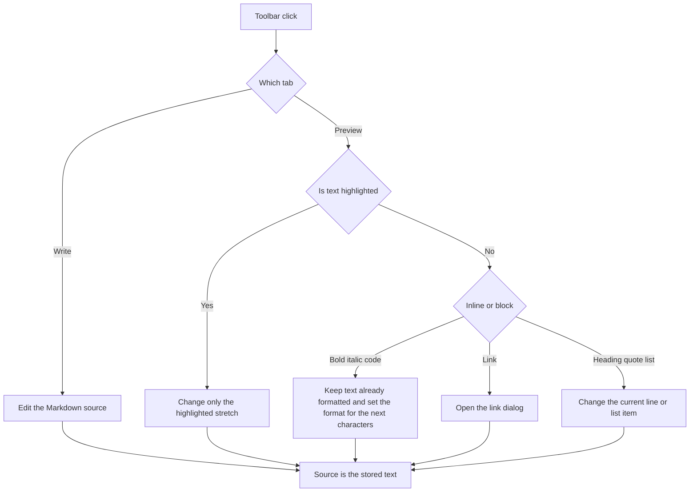

# Markdown editor behavior

* **Status:** Accepted
* **Date:** 2026-11-16

## Background

[ADR 017](markdown-descriptions-and-comments.md) renders description, definition of done, and comment bodies as sanitized Markdown. KEEL-216 added one Write / Preview editor for those fields. The behavior was discovered while fixing the editor, and the short amendment on ADR 017 does not record the cases that broke: a heading that looked bold, inline marks forced onto their own lines, a check that saved on blur, a caret click that erased formatting already written, and list buttons that did nothing in Preview.

## Problem Statement

The editor has many caret, selection, and tab-switch cases. Implementing from a one-paragraph amendment kept reintroducing bugs that had already been rejected. This feature needs an explicit behavior catalog before the next code pass.

## Objective(s)

* Record every editor behavior you specified, including the failures that must not return.
* Give a later implementation pass one checklist to verify against.
* Leave rendering, sanitizing, and storage on ADR 017.

## Scope and Deliverables

### In-Scope

* The shared editor on every web text field that supports Markdown. Today that is description, definition of done, and the comment composer on the issue page, and description and definition of done on Create.
* Write mode, Preview mode, the toolbar, save and cancel, and the no-JavaScript fallback.

### Out-of-Scope

* The phone app.
* Titles and the other plain fields.
* A preview that updates on every keystroke while typing in Write.
* Changing the stored text format, the JSON API, or the sanitizer's allowed tags.
* Syntax highlighting, math, diagrams, task lists, or strikethrough. ADR 017's renderer does not provide them.

### Deliverables

* This ADR.
* A link to it from the KEEL-216 note on ADR 017.
* No editor code change as part of accepting this record. A later pass compares the editor to every **Must** and fixes gaps.

## Technical Requirements

### Where the editor appears

* **Must** use this editor for every web text field that supports Markdown.
* **Must** make that editor the only display of the field. No rendered copy above the editor, and no Edit or Add disclosure. Posted comments stay in the thread, because a posted comment is not the field being edited.
* **Must Not** put this editor on a plain text field. Title and the other fields that do not support Markdown stay plain.
* **Must Not** change the phone app as part of this record.

### Chrome, save, and cancel

* **Must** show Write and Preview tabs at the same size as the field label, not larger.
* **Must** show a toolbar for Heading, Bold, Italic, Quote, Code, Link, Bulleted list, and Numbered list.
* **Must** show "Markdown is supported."
* **Must** put Check and Cancel on the hint row, on the right, when the field would otherwise save as soon as the user clicks outside it, or when those buttons replace a submit or Add comment button.
* **Must** leave Check inactive until the text differs from the text that was loaded. Changing it back, or Cancel, makes Check inactive again.
* **Must** make Cancel restore the loaded text.
* **Must** save that field only from Check. Leaving the editor, or clicking outside it, does not save.
* **Must** omit Check and Cancel when the field does neither of those things, including a Markdown field that only posts with a larger form such as Create. A reset control inside that form would wipe the whole form.
* **Must** keep the textarea, the note, and Check and Cancel usable when JavaScript does not run, and **Must** hide the toolbar in that case.

### Preview and the source

* **Must** show the Markdown source in Write.
* **Must** show that source rendered in Preview, through the same sanitizer as ADR 017, and **Must** accept edits there.
* **Must** write Preview edits back into the Markdown source.
* **Must** keep Preview and the source one to one. Switching Write, then Preview, then Write shows the same source.
* **Must** keep two quotes apart when a blank line stands between them. `> I am a quote`, a blank line, then `> I am a quote too` is two quotes. A following line that still starts with `>` stays in the same quote.
* **Must Not** load a preview from another origin, or from a response that is not this app's preview.

### Toolbar states

Each row is the requirement for that action in that situation. Button states names what is already true before the click. The example is the raw Markdown before the click, then the raw Markdown after it. `^` is the caret. `[text]` is the highlight. `/n` is a newline from the Enter key. Italic follows Bold, with `*` in place of `**`. A complete overlap contains both markers of a bold span, so those markers mean bold. A partial overlap contains only one side of a `**` pair, so those characters are escaped.

| Mode | Action | Caret location | Button states | Behavior | Example |
| --- | --- | --- | --- | --- | --- |
| Write | Heading button pressed | Empty text | None | Inserts `## ` before the caret. | `^` → `## ^` |
| Write | Heading button pressed | Middle of a line with text | None | Inserts `## ` at the beginning of the line. The caret stays at the same place in the text. | `Paint the ^door` → `## Paint the ^door` |
| Write | Heading button pressed | On a line that already starts with `## ` | Heading | Removes the `## ` prefix. The caret stays at the same place in the text. | `## Paint the ^door` → `Paint the ^door` |
| Preview | Heading button pressed | Empty text | None | Heading formatting applies to the text typed next. | `^` then type Title → `## Title` |
| Preview | Heading button pressed | Middle of a normal line | None | That line becomes a heading. The caret stays in the text. | `Paint the ^door` → `## Paint the ^door` |
| Preview | Heading button pressed | Inside a heading | Heading is pressed. The heading is a larger size than a normal paragraph, and it is not bold. Bold is active for only part of that text. | Clicking Heading again removes the heading, and the line becomes a normal paragraph. | `## Paint the **door**` → `Paint the **door**` |
| Preview | Enter pressed | Anywhere within a header | Header applied | Text to the right of the caret goes to the next line. Text to the left of the caret stays on the header. The heading is removed from the text on the new line. | `## I am a ^heading` → `## I am a/nheading` |
| Preview | Enter pressed | Inside a numbered item, with text between the caret and the number | Numbered list | Text to the left of the caret stays on the current item. Text to the right of the caret goes to a new line with the next number. | `1. Hello ^World` → `1. Hello/n2. World` |
| Preview | Enter pressed | On a numbered item, with no text between the caret and the number | Numbered list | The number is removed. | `1. ^There is no text to the left of the caret` → `There is no text to the left of the caret` |
| Preview | Enter pressed | Inside a bullet item, with text between the caret and the bullet | Bullet | Text to the left of the caret stays on the current item. Text to the right of the caret goes to a new line with a bullet. | `- Hello ^World` → `- Hello/n- World` |
| Preview | Enter pressed | On a bullet item, with no text between the caret and the bullet | Bullet | The bullet is removed. | `- ^There is no text to the left of the caret` → `There is no text to the left of the caret` |
| Preview | Enter pressed | On a quoted line, with no text between the caret and the start of the quote | Quote | The quote is removed. | `> ^There is no text to the left of the caret` → `There is no text to the left of the caret` |
| Preview | Enter pressed | At the end or middle of a quoted line that has text | Quote | Text to the left of the caret stays quoted. Text to the right goes to a new quoted line. At the end of the line, that new line is an empty quote. | `> I am a quote^` → `> I am a quote/n> ^` |
| Preview | Enter pressed | On an empty quoted line, with quoted text before it | Quote | The empty quote is removed. The caret goes to a new line that is not a quote. | `> I am a quote/n> ^` → `> I am a quote/n/n^` |
| Write | Bold button pressed | Empty text | None | Inserts `**` on each side of the caret so the next characters are bold. | `^` → `**^**` |
| Write | Bold button pressed | Middle of plain text | None | Inserts `**` on each side of the caret. | `Paint the ^door` → `Paint the **^**door` |
| Write | Bold button pressed | Inside bold text, nothing highlighted | Bold | Removes the surrounding `**` and leaves the words. The caret stays in the words. | `**Paint the ^door**` → `Paint the ^door` |
| Write | Bold button pressed | Highlight of plain text | None | Wraps the highlight in `**`. | `Paint the [door]` → `Paint the **door**` |
| Write | Bold button pressed | Highlight entirely inside bold text | Bold | Removes `**` from the highlighted part and leaves them on the rest. | `**Paint [the] door**` → `**Paint** the **door**` |
| Write | Bold button pressed | Complete overlap: the highlight surrounds a bold word and also includes plain text | Bold is active for only part of the highlight | Makes the whole highlight bold. Both markers are inside the highlight, so they mean bold and are removed. The highlight becomes one bold span. | `[hello **world**, how are you?]` → `**hello world, how are you?**` |
| Write | Bold button pressed | Partial overlap: the highlight includes the opening `**` and the closing `**` stays outside it | None | Inserts `**` at the start of the highlight and escapes each `**` inside the highlight. The closing `**` outside the highlight stays, so it closes the new bold. The inner `**` is not treated as bold, because the highlight does not contain the whole pair. | `[hello **world] how are you?**` → `[**hello \*\*world] how are you?**` |
| Preview | Bold button pressed | Empty text | None | Bold applies to the text typed next. | `^` then type Yes → `**Yes**` |
| Preview | Bold button pressed | Middle of plain text | None | Bold applies to the text typed next. Text already on the line stays as it is. | `Paint the ^door` then type X → `Paint the **X**door` |
| Preview | Bold button pressed | Inside bold text, nothing highlighted | Bold | Leaves the bold text already written. Bold turns off for the text typed next. | `**Hello world**^` then type ` next` → `**Hello world** next` |
| Preview | Bold button pressed | Highlight of plain text | None | Bolds the highlight only. | `Paint the [door]` → `Paint the **door**` |
| Preview | Bold button pressed | Highlight entirely inside bold text | Bold | Removes bold from the highlight only. | `**Paint [the] door**` → `**Paint** the **door**` |
| Preview | Bold button pressed | Highlighting text | Part of the highlight is already bold | The whole highlight becomes bold. The part that was already bold stays bold. | `[hello **world**]` → `**hello world**` |
| Preview | Bold button pressed | Bold text beside plain text on the same line | Bold when the caret is in the bold text | The bold text and the text beside it stay on one line. | `**Bold** and plain` stays `**Bold** and plain` |
| Write | Italic button pressed | Same locations as Bold | Same states, for italic | Same behavior as Bold, with `*` in place of `**`. | `Paint the [door]` → `Paint the *door*` |
| Preview | Italic button pressed | Same locations as Bold | Same states, for italic | Same behavior as Bold, with italic in place of bold. | `*Hello world*^` then type ` next` → `*Hello world* next` |
| Write | Code button pressed | Empty text or a caret in plain text | None | Inserts backticks around the caret. A highlight that contains a line break uses a fence instead. | `^` → `` `^` ``. A two-line highlight becomes a fenced block. |
| Write | Code button pressed | Inside inline code, nothing highlighted | Code | Removes the backticks and leaves the words. | `` `Paint the ^door` `` → `Paint the ^door` |
| Write | Code button pressed | Highlight entirely inside code | Code | Removes the code marks from the highlighted part. | `` `Paint [the] door` `` → `` `Paint` the `door` `` |
| Preview | Code button pressed | Empty text or a caret in plain text | None | Code applies to the text typed next. | `^` then type Yes → `` `Yes` `` |
| Preview | Code button pressed | Inside code, nothing highlighted | Code | Clicking Code again removes the code, and the text becomes normal. The caret stays in the same place. | `` `hello ^world` `` → `hello ^world` |
| Preview | Code button pressed | Highlight entirely inside code | Code | Removes code from the highlight only. | `` `Paint [the] door` `` → `` `Paint` the `door` `` |
| Write | Link button pressed | Empty text or a caret in plain text | None | Inserts a link. The visible text is the highlight, or the word "text" when nothing is highlighted. The URL is ready to edit. | `[door]` → `[door](url)`. Nothing highlighted → `[text](url)` |
| Write | Link button pressed | Caret inside a link, nothing highlighted | Link | Replaces the link with its visible text. | `[Paint the ^door](url)` → `Paint the ^door` |
| Write | Link button pressed | Highlight is only part of a link | Link | A partial highlight counts as a highlight of the entire link text. The link is replaced with that entire visible text. | `[Paint [the] door](url)` counts as `[Paint the door]` highlighted → `Paint the door` |
| Write | Link button pressed | Highlight contains a whole link and also includes other text | Link | A highlight that contains a link counts as a highlight of that entire link text. The surrounding text stays as it is. The link is replaced with that entire visible text. | `[See [the door](url) today]` counts as `[the door]` highlighted → `See the door today` |
| Write | Link button pressed | Highlight contains two links | Undefined | The behavior is undefined. Nothing is done. | `[See [the door](url) and [the frame](url)]` stays `[See [the door](url) and [the frame](url)]` |
| Preview | Link button pressed | Empty text or a caret in plain text | None | Opens a dialog with the text value, the link value, Remove link, Cancel, and OK. Remove link removes the link. Cancel leaves the text as it was. OK updates the link from those values. | `[door]` opens the dialog. Cancel leaves `door`. OK with text `door` and link `url` → `[door](url)` |
| Preview | Link button pressed | Caret inside a link, nothing highlighted | Link | Opens the same dialog with that link's text and link values. Clicking the link text does not navigate. Remove link removes the link. Cancel leaves the link as it was. OK updates the link. | `[Paint the door](url)` opens the dialog. Cancel leaves `[Paint the door](url)`. Remove link → `Paint the door` |
| Preview | Link button pressed | Highlight is only part of a link | Link | A partial highlight counts as a highlight of the entire link text. The dialog opens with that entire text and the link's URL. Remove link removes the whole link. Cancel leaves the link as it was. OK updates the whole link. | `[Paint [the] door](url)` counts as `[Paint the door]` highlighted. The dialog opens with text `Paint the door` and link `url`. Cancel leaves `[Paint the door](url)`. Remove link → `Paint the door` |
| Preview | Link button pressed | Highlight contains a whole link and also includes other text | Link | A highlight that contains a link counts as a highlight of that entire link text. The dialog opens with that entire text and the link's URL. The surrounding text stays as it is. Remove link removes the whole link. Cancel leaves the text as it was. OK updates the whole link. | `[See [the door](url) today]` counts as `[the door]` highlighted. The dialog opens with text `the door` and link `url`. Cancel leaves `See [the door](url) today`. Remove link → `See the door today` |
| Preview | Link button pressed | Highlight contains two links | Undefined | The behavior is undefined. Nothing is done. The dialog does not open. | `[See [the door](url) and [the frame](url)]` stays `[See [the door](url) and [the frame](url)]` |
| Write | Quote button pressed | Empty text | None | Inserts `> ` before the caret. | `^` → `> ^` |
| Write | Quote button pressed | Middle of a line with text | None | Inserts `> ` at the beginning of the line. The caret stays at the same place in the text. | `Paint the ^door` → `> Paint the ^door` |
| Write | Quote button pressed | On a line that already starts with `> ` | Quote | Removes the `> ` prefix. The caret stays at the same place in the text. | `> Paint the ^door` → `Paint the ^door` |
| Write | Quote button pressed | Highlight of plain text | None | Inserts `> ` at the beginning of each highlighted line. A highlight of part of a line quotes that whole line. | `Paint the [door]` → `> Paint the door` |
| Write | Quote button pressed | Highlight entirely inside a quote | Quote | Removes the `> ` prefix from each highlighted line. | `> Paint the [door]` → `Paint the door` |
| Write | Quote button pressed | Highlight includes a quoted line and a plain line | Quote is active for only part of the highlight | Removes the quote from each quoted line in the highlight. Plain lines stay plain. | `[Paint the door]` and `> Sand the frame` → `Paint the door` and `Sand the frame` |
| Preview | Quote button pressed | Empty text | None | Quote formatting applies to the text typed next. | `^` then type Note → `> Note` |
| Preview | Quote button pressed | Middle of a normal line | None | That line becomes a quote. | `Paint the ^door` → `> Paint the ^door` |
| Preview | Quote button pressed | Inside a quote | Quote | Removes the quote from that block. | `> Paint the ^door` → `Paint the ^door` |
| Preview | Quote button pressed | Highlight of plain text | None | Each highlighted line becomes a quote. A highlight of part of a line quotes that whole line. | `Paint the [door]` → `> Paint the door` |
| Preview | Quote button pressed | Highlight entirely inside a quote | Quote | Removes the quote from each highlighted line. | `> Paint the [door]` → `Paint the door` |
| Preview | Quote button pressed | Highlight includes a quote and plain text | Quote is active for only part of the highlight | Removes the quote from each quoted line in the highlight. Plain lines stay plain. | `[Paint the door]` and `> Sand the frame` → `Paint the door` and `Sand the frame` |
| Write | Bullet button pressed | Empty text | None | Inserts `- ` before the caret. | `^` → `- ^` |
| Write | Bullet button pressed | Middle of a line with text | None | Inserts `- ` at the beginning of the line. The caret stays at the same place in the text. | `Paint the ^door` → `- Paint the ^door` |
| Write | Bullet button pressed | On a line that already starts with `- ` | Bullet | Removes the `- ` prefix. The caret stays at the same place in the text. | `- Paint the ^door` → `Paint the ^door` |
| Preview | Bullet button pressed | Empty text | None | A bullet item is ready for the text typed next. | `^` then type One → `- One` |
| Preview | Bullet button pressed | Middle of a normal line | None | That line becomes a bullet item. A disc marker shows. | `Paint the door` → `- Paint the door` |
| Preview | Bullet button pressed | Inside a bullet item | Bullet | Removes the bullet from that item. | `- Paint the ^door` → `Paint the ^door` |
| Preview | Bullet button pressed | Inside a numbered item | Number | Converts that list to bullets. Disc markers show. | `1. Paint the door` → `- Paint the door` |
| Write | Number button pressed | Empty text | None | Inserts `1. ` before the caret. | `^` → `1. ^` |
| Write | Number button pressed | Middle of a line with text | None | Inserts `1. ` at the beginning of the line. The caret stays at the same place in the text. | `Paint the ^door` → `1. Paint the ^door` |
| Write | Number button pressed | On a line that already starts with a number prefix | Number | Removes the number prefix. The caret stays at the same place in the text. | `1. Paint the ^door` → `Paint the ^door` |
| Preview | Number button pressed | Empty text | None | A numbered item is ready for the text typed next. | `^` then type One → `1. One` |
| Preview | Number button pressed | Middle of a normal line | None | That line becomes a numbered item. A number shows. | `Paint the door` → `1. Paint the door` |
| Preview | Number button pressed | Inside a numbered item | Number | Removes the number from that item. | `1. Paint the ^door` → `Paint the ^door` |
| Preview | Number button pressed | Inside a bullet item | Bullet | Converts that list to numbers. Numbers show. | `- Paint the door` → `1. Paint the door` |

A highlight that covers several lines uses the same rule on each line. Several highlighted blocks in Preview become one list, one item per block. Enter in Preview inserts a line break, except inside a heading, a quote, a list item, or a code block. Inside a heading, or inside a list item that already has text before the caret, the Enter rows apply. Inside a quote, Enter starts another quoted line when the current line has text, and the next Enter on that empty quoted line leaves the quote. At the start of a quote or list item, Enter removes that marker. Inside a code block, Enter keeps the block.

### Mistakes that must not return

* **Must Not** require a highlight before a list or heading button can run.
* **Must Not** let a caret click on Bold or Italic erase formatting that was already written. That click only changes what is typed next, unless a stretch is highlighted.
* **Must Not** build Preview lists with the browser list command. That command does nothing in this editor. The editor builds the list itself.
* **Must Not** ask the browser whether the caret is bold. A heading's weight made Bold look pressed, and turning that off did not survive a return to Write.
* **Must Not** flatten every heading to the same size and weight as body text.
* **Must Not** save a Markdown field because it lost focus.
* **Must Not** show a second rendered copy of a Markdown field above its editor.
* **Must Not** put Check and Cancel on a Markdown field that neither saved on click-outside nor had its own submit or Add comment button.

## Consequences

* **Good:** The next code pass can be checked against a case list instead of against memory of the bugs.
* **Good:** ADR 017 stays about rendering and sanitizing.
* **Bad:** The catalog is longer than the project's usual ADR, and a behavior change means editing this record first.
* **Risk:** A table row may not match what you want. Correct the row in this review. Code is not changed until you ask for the audit.

## System Design

### Technical Stack and Architecture

The editor is one partial, [src/keel/web/templates/_markdown_field.html](../../src/keel/web/templates/_markdown_field.html), used by every web text field that supports Markdown. [assets/js/markdown-field.js](../../assets/js/markdown-field.js) binds Write, Preview, the toolbar, and Check. Preview posts the source to the existing preview route and writes the edited HTML back to Markdown with the same tags ADR 017 allows. Styling stays in [assets/brand.css](../../assets/brand.css). No new stored field, API, or sanitizer rule.

### UML Diagrams

The diagram above is the toolbar decision this record is locking. Save on the issue page is a separate path: Check posts the field, Cancel restores the loaded text, and leaving the field does neither.

## Supporting Documentation

* [ADR 017](markdown-descriptions-and-comments.md)
* [Issue definition of done](issue-definition-of-done.md)

## Assumptions

* The phone app remains unchanged.
* Every web text field that supports Markdown uses this editor. Where that field is on the page is decided by the record for that field, not by this one.
* Check and Cancel appear when the field would otherwise save as soon as the user clicks outside it, or when they replace a submit or Add comment button. A field that only posts with a larger form, including Create, does not get them.
* Every table row stands unless you change it in this review.
* Accepting this record only writes the ADR and the link from ADR 017. Comparing the code to the catalog is a later request.
