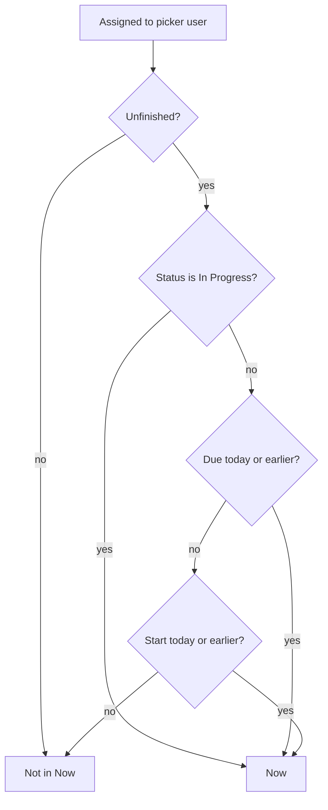

# Now on the home inbox

* **Status:** Accepted
* **Date:** 2026-10-27

## Background

`/` is the acting user's personal inbox ([ADR 022](personal-work-inbox.md)). Time-sensitive sections already split unfinished assigned work into **Due or overdue** and **Starting or started**, then look-ahead due dates, then the full assigned list. The same issue may appear in more than one section. Empty sections are omitted. This browser can fold, remove, and reorder the panels ([Collapsible home inbox sections](collapsible-home-inbox-sections.md), [Customizable home panels](customizable-home-panels.md)). The phone app builds the same sections from saved and remote issues.

KEEL-109 asks for one home widget whose rows are issues that have started or are starting, are due or overdue, or are in progress, on the web home screen and in the mobile app. The ticket left the name open.

## Problem Statement

Due or overdue and Starting or started answer two calendar questions, and they stay separate. Work whose status is *In Progress* and that has no start or due date only shows up inside Assigned to me. There is no single list of the assigned work that is already in motion: the start date has arrived, the due date has arrived, or someone has moved it to *In Progress*.

## Objective(s)

- Show that combined list on `/` and on the phone home screen.
- Name it so the heading stays as short as the other panels.
- Leave the existing sections and their membership alone.

## Scope and Deliverables

### In-Scope

* A home section titled **Now**, first among non-empty sections, on the web inbox and the mobile home screen.
* Membership: unfinished issues assigned to the acting user that are due or overdue, or whose start calendar date is today or earlier, or whose status is *In Progress*. An issue that matches more than one of those is listed once.
* A Due column on those rows. Start is already on every web inbox row.
* Collapse, remove, and reorder through the existing `now` key.
* The same rule on the phone, including the saved offline copy.

### Out-of-Scope

* Replacing Due or overdue, Starting or started, or Assigned to me.
* Treating *In Review* as *In Progress*.
* A new table, a JSON inbox route, or a phone home-screen widget outside the app.
* Changing who is assigned, or showing unassigned work.

### Deliverables

* This ADR as the behavior source of truth.
* The section on `/` and in the mobile home list.
* Updates to the UI design, use cases, and the home inbox ADRs.

## Technical Requirements

* **Must** add a home section titled **Now**, rendered first among non-empty sections, before Due or overdue.
* **Must** include only issues whose assignee is the acting user.
* **Must** include an unfinished assigned issue when any of these is true: status is *In Progress*; `due_at` calendar date is local today or earlier; `start_at` calendar date is local today or earlier.
* **Must** list that issue once in **Now** even when it matches more than one of those rules.
* **Must** keep the same issue in Due or overdue, Starting or started, and the other sections whose rules it already matches.
* **Must Not** include *Done* or *Cancelled*.
* **Must Not** include an unfinished issue that is only due later, or only starting later, while its status is not *In Progress*.
* **Must Not** treat *In Review* or *Blocked* as *In Progress*. A blocked or in-review issue still appears when its start or due date has arrived.
* **Must** sort due or overdue rows first by due time, then started rows whose due date has not arrived by start time, then remaining *In Progress* rows by project key and issue number.
* **Must** show the existing inbox row plus a **Due** column. A blank due cell is fine when the row is here because of start or status.
* **Must** hide the section when it has no rows. A home that holds only this section **Must** still render it.
* **Must** store `now` as a known home section key for collapse (`keel_inbox`) and layout (`keel_home`). A saved layout that predates this section **Must** keep **Now** visible.
* **Must** apply the same membership and order in the mobile app. Offline, when the phone does not have a full saved catalog, **Now** **Must** show the saved sprint rows that match and say that other issues need a connection, the same way Due or overdue does.
* **Must Not** change Due or overdue or Starting or started membership.

## Consequences

* **Good:** Opening home starts with one list of assigned work that is already in motion, including *In Progress* issues that have no dates.
* **Good:** The split panels stay, so a person can remove **Now** or remove the splits and keep one list.
* **Bad:** A due issue that has also started appears in **Now**, Due or overdue, and Starting or started.
* **Risk:** *In Progress* with a future due date sits in **Now** beside work that is due today. The Due column shows that the date is still ahead. Accepted so status membership does not wait on the calendar.

## System Design

### Technical Stack and Architecture

Web membership is computed in `keel.services.home` with the other inbox sections and rendered by the existing `/` template. The phone computes the same groups in `mobile/src/inbox.js` from remote issues or the saved library. No new table and no JSON route. Collapse and layout reuse `now` in the existing cookies and the phone's home layout store.

### UML Diagrams

## Supporting Documentation

* [ADR 022: Home page as a personal work inbox](personal-work-inbox.md)
* [ADR 029: Issue start date/time and series start/due offsets](ADR-029.md)
* [Due this week and due this month as separate home panels](due-this-week-and-due-this-month-home-panels.md)
* [Customizable home panels](customizable-home-panels.md)
* [Collapsible home inbox sections](collapsible-home-inbox-sections.md)
