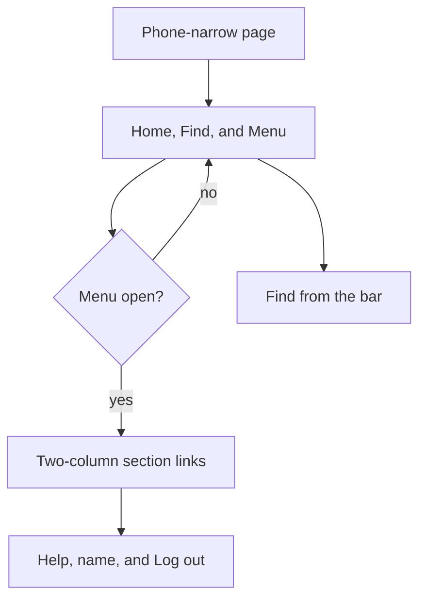

# Phone menu

* **Status:** Accepted
* **Date:** 2026-10-14

## Background

[ADR 018](phone-layout.md) lays the same Keel pages out for a phone. Its top bar kept every control on screen and let them wrap: home, the section links, Find, Help, and the signed-in account. That bar is what a phone shows today. Inside a project the section list is Projects, Create, Board, Calendar, Backlog, Sprints, Schedules, and Users, and the account line adds Help, the signed-in name, and Log out.

Help is already a native disclosure ([ADR 023](ADR-023.md)). Section order is a cookie, changed by dragging or by Up and Down when JavaScript has not run ([ADR 001](persistent-top-menu-bar.md)).

## Problem Statement

On a phone the wrapped bar is hard to use. The links break into uneven rows, Find sits in whatever gap is left, and the account line wraps under them. The stack is several rows tall before the page content starts, and the targets are the same small chips as on a desktop. A wide window does not have this problem and must stay as it is.

## Objective(s)

- Make the phone bar one short row that is easy to scan and tap.
- Keep Find and Home usable without an extra step.
- Put the section links, Help, and the account behind one control, with large targets.
- Leave the wide-viewport bar unchanged, including source order of home, sections, Find, Help, and the account.

## Scope and Deliverables

### In-Scope

- A phone-narrow Menu control on the shared top bar.
- The open panel: section links in a two-column grid, then Help, the signed-in name, and Log out.
- The same no-JavaScript reorder controls inside that panel.
- Amendments to [ADR 018](phone-layout.md) and [ADR 023](ADR-023.md) so a phone may keep sections and the account behind Menu.

### Out-of-Scope

- A different desktop bar, a new route, or a native app.
- Changing what the section links, Find, Help, or Log out do.
- Reordering sections by a new gesture.

### Deliverables

- This ADR.
- The Menu control in the shared chrome, active only inside the phone-narrow media query.
- The narrow-viewport note in [UI design](../design/ui.md).

## Technical Requirements

* **Must** show Home, Find, and Menu on one row when the viewport is phone-narrow and Menu is closed.
* **Must** keep Find usable while Menu is closed.
* **Must** open Menu without JavaScript. The control is a checkbox and its label, because the section list has to stay between Home and Find in the page source.
* **Must** show the section links in their cookie order, in two equal columns, while Menu is open.
* **Must** show Help, the signed-in name (linking to the profile), and Log out in that open panel.
* **Must** keep Up and Down beside each section link when the nav script has not run, and keep drag reorder when it has.
* **Must** hide the Menu control on a wide viewport and show the section links, Find, Help, and the account on the bar as they are today.
* **Must** switch with the same phone-narrow breakpoint as [ADR 018](phone-layout.md).
* **May** grow the sticky bar while Menu is open.
* **May** omit the “Signed in” caption on a phone. The name remains.
* **Must Not** add a script whose only job is to open Menu.
* **Must Not** remove a section link, Find, Help, or Log out from the page.
* **Must Not** change the wide-viewport layout.

## Consequences

* **Good:** A phone shows one row until the person asks for navigation. The targets in the open panel are large and aligned.
* **Bad:** Sections, Help, and Log out take one tap that a wide window does not. The open panel is tall.
* **Risk:** The checkbox has to stay ahead of the section list and the account in the source, or the closed state cannot hide them. A later edit that moves those nodes will leave the links on the bar.

## System Design

### Technical Stack and Architecture

The control lives in `base.html`, after the home link and before the section nav. A hidden checkbox and a label that reads Menu, or Close while checked. The phone-narrow block in `assets/brand.css` hides the section nav and the right cluster until that checkbox is checked, then lays the links out in two columns and the account row in three. Wide viewports set the checkbox and the label to `display: none`, so they take no space and are not in the tab order. No new route and no new script.

### UML Diagrams

## Supporting Documentation

* [ADR 018: Phone layout of the existing site](phone-layout.md)
* [ADR 023: Help menu links to FastAPI API docs](ADR-023.md)
* [ADR 001: Persistent top menu bar](persistent-top-menu-bar.md)
* [UI design](../design/ui.md)
