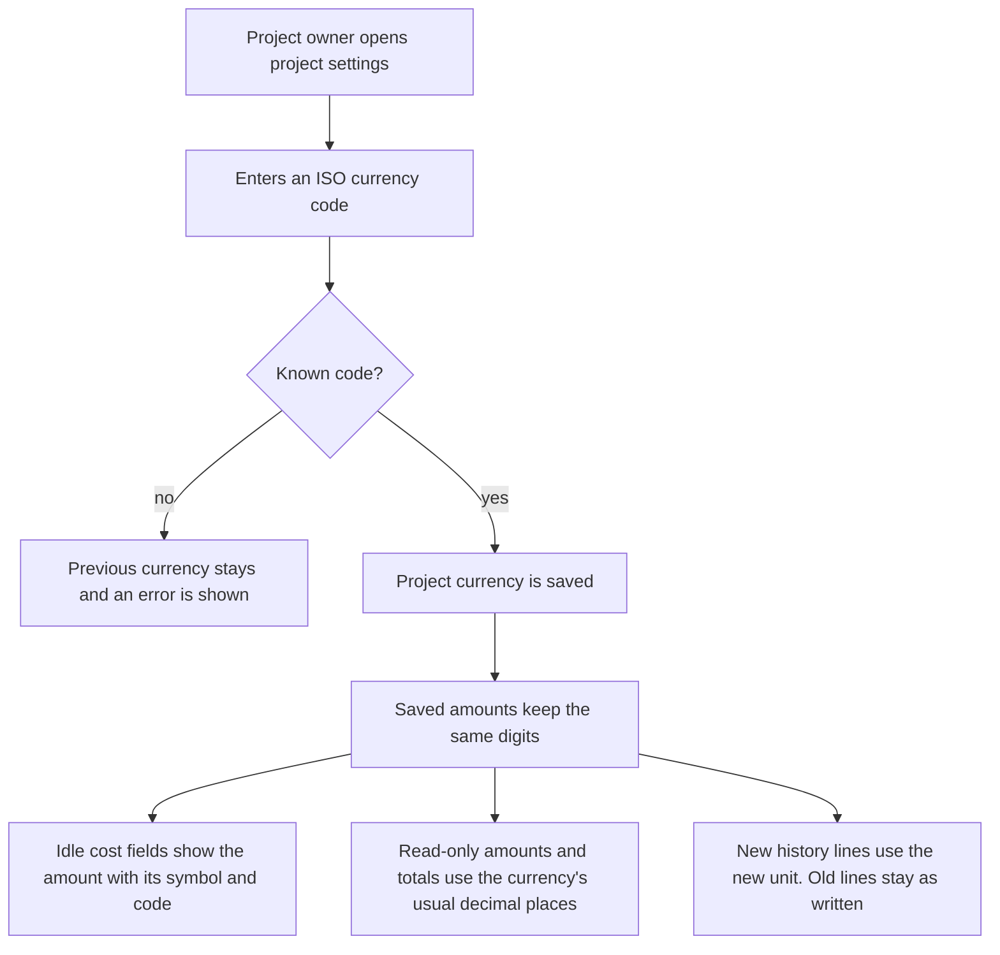

# Project currency

* **Status:** Accepted
* **Date:** 2026-11-02

## Background

Issues already store planned value, earned value, and actual cost, and parents show those amounts for the subtree ([Cost estimation](cost-estimation.md)). That record treated every amount as dollars. Projects already have a settings panel on the project page for name, description, and sprint cadence. The Project Owner role is the one that can change those settings.

## Problem Statement

Cost was always presented as dollars. A project that works in another currency had no way to say so, so the unit on every cost field was wrong for that project. People still need the amounts they already entered to stay the same numbers when the label changes.

## Objective(s)

- Let a project owner choose the currency for a project, starting at USD.
- Show that currency as the unit on planned value, earned value, actual cost, and the totals derived from them.
- Leave every stored amount numerically unchanged when the currency changes.

## Scope and Deliverables

### In-Scope

* One currency per project, chosen on the existing project settings panel. Existing projects and new projects start as USD.
* Any real ISO 4217 alphabetic code. The code is shown on every cost amount. Common currencies also show a symbol in front of the number.
* The same unit on the website issue page, the website create form, and the phone create, edit, and detail screens.
* History lines for a cost edit written with the unit in effect at that moment. Later currency changes do not rewrite those lines.
* Entry that accepts a bare number or the formatted value people see in the field.

### Out-of-Scope

* Exchange rates, or rewriting an amount because the currency changed.
* A different currency on a single issue, a sprint, or a person.
* Editing budget at completion, estimate at completion, or either performance index.
* Cost or currency on a board card, or on a repeating-work recipe.
* Charts or other reports.

### Deliverables

* A currency control on project settings, visible to people who can change those settings.
* Cost fields and totals labeled with that project's currency on the website and the phone.
* History text that keeps the unit from the time of the edit.
* This decision recorded, and the dollar-only line in [Cost estimation](cost-estimation.md) pointed at it.

## Technical Requirements

* **Must** default every project to USD until a project owner chooses another currency.
* **Must** accept only a real ISO 4217 alphabetic code. An unknown or blank code is refused, and the previous currency stays.
* **Must** keep the same digits when the currency changes. 12.50 USD becomes 12.50 in the new unit. There is no conversion.
* **Must** show the currency code on every displayed amount. For USD, EUR, GBP, CAD, AUD, NZD, JPY, CNY, INR, MXN, BRL, CHF, SEK, NOK, DKK, SGD, HKD, KRW, and ZAR, **Must** also show that currency's symbol before the number, as in `$12.50 USD` or `¥12 JPY`.
* **Must** show the symbol and code inside a cost field that is not being edited, as in `$12.50 USD`. While the field is being edited, it shows only the number.
* **Must** show two decimal places in an edit field, matching the stored amount, so a hidden fraction is visible while editing. An empty field shows zero at that precision when it is not being edited (`$0.00 USD`, `¥0.00 JPY`) and does not store zero until the person actually changes it.
* **Must** show read-only amounts and totals in the currency's usual decimal places when that is zero or two. A zero-decimal total drops the fraction: stored 12.90 shows as `¥12 JPY`. Zero shows as `$0.00 USD` or `¥0 JPY`, not the word "none".
* **Must** keep showing two decimal places for a currency whose official minor unit is three or four. A third decimal typed into a field is refused.
* **Must** accept a bare amount (`12`, `12.50`, `1,234.56`) and the formatted field value. A symbol or code for a different currency is refused.
* **Must** record a cost history line with the full stored amount and the currency in effect when the edit is saved. Changing the project currency **Must Not** rewrite old lines and **Must Not** add a cost history line by itself.
* **Must** leave schedule and cost performance indexes as plain numbers, still shown as "N/A" when they are undefined.
* **May** be changed by anyone who can already change that project's settings, which is the Project Owner role and any custom grant of that same permission.
* **Must Not** let a contributor or viewer change the currency. They still see the unit on issues they can view.
* **Must Not** put the currency on a board card or copy it onto issues spawned from a recipe. Spawned issues still start with cost unset, and show the project's currency once an amount is entered.

## Consequences

* **Good:** Each project can label cost in the currency it actually uses, and amounts already entered do not move when the label changes. History still says what unit was on screen when someone saved an edit.
* **Bad:** Switching from USD to EUR leaves 12.50 looking like 12.50 euros. A yen total can hide a fraction that still exists until someone opens the field. Several currencies share a symbol, so the code has to carry the distinction.
* **Risk:** A project owner may believe the numbers were converted. A read-only yen total can look smaller than the amount in the edit field.

## System Design

### Technical Stack and Architecture

This stays on the surfaces that already exist. The currency control is on project settings on the project page, next to name and sprint cadence, and on the phone's project settings, and uses the same permission as those settings. The website issue page and create form, and the phone create, edit, and detail screens, format the cost fields they already show. Issue history keeps a text line per cost edit. No new screen, role, or calculated figure is added. The code is a column on the project. The accepted ISO codes and their minor units live with the money formatting.

### UML Diagrams

## Supporting Documentation

* [Cost estimation](cost-estimation.md)
* [Role-based access](role-based-access.md)
