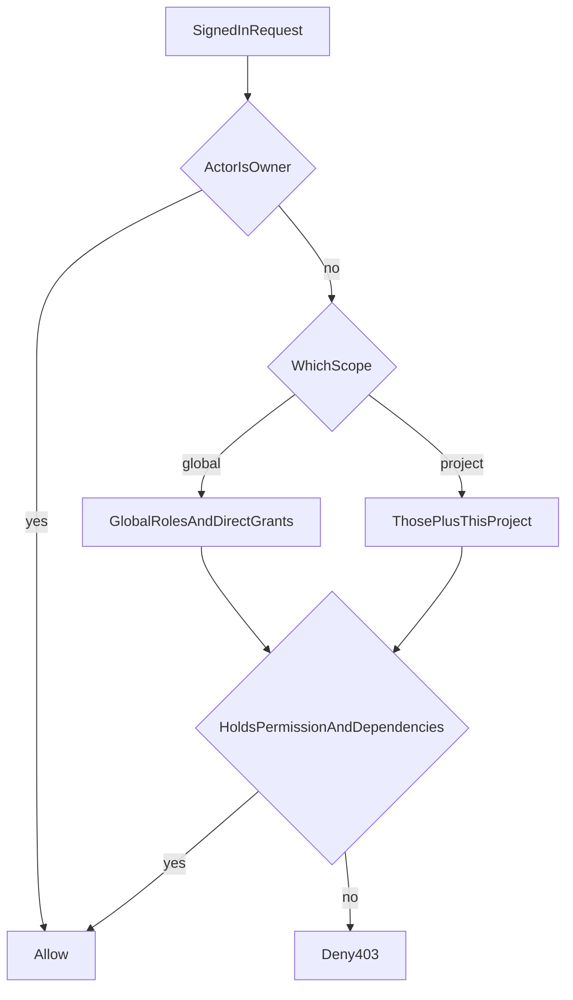

# Role-based access

* **Status:** Accepted
* **Date:** 2026-10-20

## Background

Keel signs people in with a username and password or a personal API token ([Password login](password-login.md)). After that, every signed-in person could do the same things. [v1 scope](../architecture/v1-scope.md) deferred roles. The Admin menu showed Log tracker to everyone ([Log tracker](log-tracker.md)). KEEL-67 asks for global permissions and project permissions, a written map before the checks, and tests around that map.

This record is that map. The catalog is [RBAC catalog](../design/rbac-catalog.md). Checks live in the domain and services so HTML and `/api/v1` share one rule ([Layered module structure](layered-module-structure.md)).

## Problem Statement

A household tracker now has people who should not all administer the server or all open every project. There was no place that recorded a role, a permission, or the rule that one permission requires another.

## Objective(s)

- Give Owner unrestricted access, and give everyone else only the roles and direct grants they hold.
- Keep an Admin who can run the server without automatically entering a project.
- Keep project work on Project Owner, Contributor, and Viewer.
- Give every other person the global role Member, which can see projects and holds the global create and edit permissions for issues and schedules, plus the global permission to create comments.
- Refuse a grant that omits a permission it depends on.
- On the current server, record the day-one grants named in the catalog.
- Show a signed-in person a forbidden page when a global action is refused, distinct from the login redirect.

## Scope and Deliverables

### In-Scope

* Global roles Owner, Admin, and Member, and project roles Project Owner, Contributor, and Viewer.
* Direct permission grants in addition to a role.
* Dependency closure when a grant is saved.
* The global RBAC page at `/admin/access`, and `GET`/`PUT /api/v1/access/global`.
* Hiding the Admin menu, the Users link, and the buttons for global actions the person cannot perform.
* A signed-in forbidden page for those global pages, and 403 from the API.
* A migration that seeds the catalog and the day-one grants, including project roles.
* Global enforcement: Admin menu, Log tracker, the Users management page, create, rename, delete, and password reset, create and delete projects, and the project list.

### Out-of-Scope

* Project route checks (issues, board, calendar, backlog, sprints, schedules, project settings, project RBAC). Those are KEEL-105. Until then a signed-in person can still open a project URL. The project list is already filtered.
* Single sign-on, a second factor, and email password reset.
* A deny flag.
* Putting server CLI backup, restore, `keel users set-password`, or `keel users create-token` behind a web permission.
* A feature flag that turns enforcement off.

### Deliverables

* This record and the [RBAC catalog](../design/rbac-catalog.md).
* Tables, the seed, the global page, and the global checks.

## Technical Requirements

* **Must** treat Owner as a bypass of every global and project check. Owner does not depend on also holding Admin.
* **Must** allow more than one Owner. **Must** allow only an Owner to grant or revoke Owner. **Must Not** allow the last Owner to be removed, including by deleting that user.
* **Must** give Admin every global permission and no project permission.
* **Must** give every person a global role. Member is the default and holds View projects, the global create and edit permissions for issues and schedules, and the global Create comments permission. Granting Owner or Admin replaces Member. Removing the last of those assigns Member again.
* **Must** require both a global permission and the matching project permission to create, edit, or delete issues, schedules, or sprints, and to create or delete comments. The global permission is necessary and is not sufficient to do that action in every project. One global Delete comments permission covers deleting one's own comments and deleting anyone's comments. Starting or completing a sprint, and updating an issue's status, assignee, or sprint placement, have no global gate.
* **Must** assign Member when a person is created.
* **Must** give the creator of a project the Project Owner role on that project.
* **Must** compute access as the union of role permissions and direct grants. **Must Not** store a deny.
* **Must** on save, add missing dependencies and remove grants whose dependency was removed. A stored permission whose dependency is absent does not count at check time.
* **Must** keep the Users management page under the Admin menu, shown only with View users. The people directory `GET /api/v1/users` stays available to every signed-in person so assignee lists and the phone app can read display names.
* **Must** show the Admin menu with Display Admin menu, and also when View users is the only item that person can open. Users, Log tracker, and Access live under that menu.
* **Must** hide a global nav link or button the person cannot use. **Must** answer a typed global page with the forbidden page, and the matching API call with 403. **Must Not** send that person to `/login`.
* **Must** let every signed-in person open their profile, change their own password, manage their own API tokens, arrange home and nav, sign out, and open Help and License.
* **Must** keep the rule that a person cannot delete their own user.
* **Must** show the project list as every project when the person has View projects or is Owner, and otherwise only the projects where they hold a project role or a direct project grant.
* **Must** reset another person's password only with that permission, and refuse to use it on the signed-in person.
* **May** show an empty project list when the person can see no project.
* **Must Not** require a permission to sign in, to call `GET /health`, or to load `/assets/`.

The permission list, role bundles, dependencies, and day-one usernames are the catalog.

## Consequences

* **Good:** jacob_hootman is Owner and Project Owner on the current projects. Cursor is Member and Contributor on KEEL. danielle_hootman is Member and Contributor on HOUSE. Admin can be given later without handing over those projects.
* **Bad:** Every new global page and API route has to name the permission it needs. Until KEEL-105, a project URL is still open to any signed-in person even when the list hides that project.
* **Risk:** A missed global check leaves an action open. The catalog and the route tests are what catch that. The day-one project rows do not restrict anyone until the project checks exist.

## System Design

### Technical Stack and Architecture

The same FastAPI app, SQLite database, Alembic migration, and Jinja pages. Pure allow-or-deny rules live in `src/keel/domain/access.py`. `src/keel/services/access.py` loads roles and direct grants and is the only writer. HTML routes and `/api/v1` call it before a global read or change. `resolve_current_user` still only answers who is signed in.

Stored shape: `permissions`, `permission_dependencies`, `roles`, `role_permissions`, `user_roles`, and `user_permissions`. A global row leaves `project_id` empty. Owner is the role with `bypass` and has no rows in `role_permissions`. Member's rows are View projects, the global create and edit permissions for issues and schedules, and Create comments. Startup seeds the catalog and guarantees an Owner. The upgrade also writes the day-one project roles. Creating a user assigns Member. Creating a project assigns Project Owner to the creator. A project create, edit, or delete of issues, schedules, or sprints, and creating or deleting comments, is kept only when the matching global permission is held. Project routes do not call that rule until KEEL-105.

A missing global permission becomes `access.denied`. HTML renders `forbidden.html` inside the normal shell. The API returns 403 and the domain error body. A person who is not signed in still goes to `/login`, or receives 401 from the API.

### UML Diagrams

Project checks in that diagram are defined and stored. KEEL-105 is what calls them from project routes.

## Supporting Documentation

* [RBAC catalog](../design/rbac-catalog.md)
* [Password login](password-login.md)
* [Log tracker](log-tracker.md)
* [Layered module structure](layered-module-structure.md)
* [v1 scope](../architecture/v1-scope.md)
