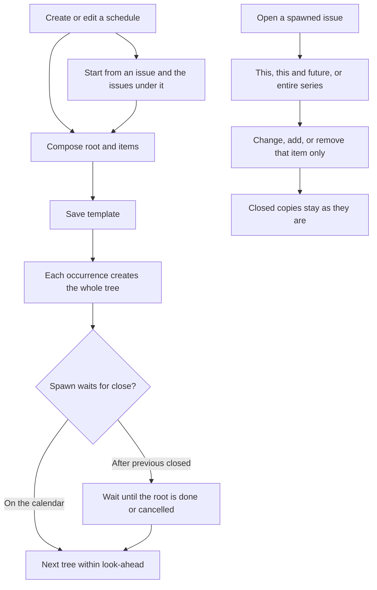

# Structured scheduled issues

* **Status:** Accepted
* **Date:** 2026-11-04

## Background

Repeating work is a schedule (a series): one recipe plus a cadence that spawns an ordinary issue per occurrence. That behavior is [Repeating work via Scheduling Manager](repeating-work-scheduling-manager.md). A recipe today is a single epic, story, or subtask, with its own title, description, priority, labels, assignee, and start and due offsets. The schedule owns the cadence, when the next copy appears, which date places copies in a sprint, and how many occurrences to keep ahead. From an occurrence, recipe edits offer this occurrence, this and all future, or the entire series. Closed copies stay as they are. Saving the schedule page updates the recipe for later spawns and leaves issues that already exist alone.

Issue hierarchy is unchanged: an epic has no parent, a story sits under an epic, and a subtask sits under a story ([Unified issue model](unified-issue-model.md)). The repeating-work record listed “spawning a tree of children from one tick” as out of scope. KEEL-107 is that capability. The example is an annual tax filing: an epic, stories under it, and a subtask under a story, created together the way one scheduled issue is created today.

## Problem Statement

A job that comes back on a cadence is often several linked issues, not one card. Filing taxes each year needs the epic, the federal story, the state story, and the form subtask. Today the user can schedule only one of those, then rebuild the rest by hand after every spawn. Parent and children drift apart, and “after the previous copy is closed” cannot see the set.

## Objective(s)

- Let a person who can create a schedule define a tree of issues that is created together on each occurrence.
- Keep each item’s own title, type, description, priority, labels, assignee, and start and due offsets.
- Keep one cadence, one spawn rule, one sprint basis, and one look-ahead for the whole schedule.
- Let the next copy, when the schedule waits for the previous copy to close, wait only until the root is done or cancelled.
- Offer the same tree on the web and on the phone, including starting from an issue that already has children.

## Scope and Deliverables

### In-Scope

* A schedule whose recipe is a tree: one root and zero or more items under it, each with one parent, down through epic, story, and subtask.
* Each item carries its own title, type, description, priority, labels, assignee, and start and due offsets. Either date may be blank, and that item is created without that date.
* The schedule still owns cadence, spawn mode (on the calendar, or after the previous root is closed), sprint basis, look-ahead, pause, resume, and delete-schedule.
* Creating or editing that tree on the web Schedules pages and in the phone schedule editor.
* Starting a schedule from an existing issue copies that issue and every issue already under it, including subtasks under stories. Those issues are the first occurrence. The template is taken from them.
* From an occurrence, editing one item’s fields, adding an item, or removing an item asks: this occurrence, this and all future, or the entire series. The choice applies only to that item.
* A schedule with no children behaves as a single-issue schedule does today.

### Out-of-Scope

* A new issue type, or a change to who may parent whom.
* Estimates, definition of done, location, comments, or dependency links on the template.
* Putting the recipe itself on the board.
* Deleting every spawned issue when the schedule is deleted. Spawned issues remain, as they do today.
* Rewriting a closed copy’s fields, or adding or removing items on a closed copy.
* Reordering siblings. New items append under their parent.
* Offline authoring. The phone already requires a connection for schedules; this feature does too.
* A second way to count look-ahead. Look-ahead stays a count of occurrences.

### Deliverables

* This record, as the behavior source of truth.
* A short amendment note on [Repeating work via Scheduling Manager](repeating-work-scheduling-manager.md) pointing here, so “no tree from one tick” stays historical.
* Web, phone, and spawn behavior that matches this record.

## Technical Requirements

* **Must** let a schedule spawn one linked tree per occurrence. The root and its items are ordinary issues. Each child is parented to its item’s parent in that same occurrence.
* **Must** allow the root to be an epic, a story, or a subtask. A story root may still name an existing epic as its parent. A subtask root may still name an existing story. An epic root has no parent. Items inside the tree follow the same parent rules.
* **Must** give every item its own title, type, description, priority, labels, assignee, and start offset and time, and due offset and time.
* **Must** keep cadence, spawn mode, sprint basis, look-ahead, pause, and resume on the schedule. Pause creates no further trees. Resume continues the schedule.
* **Must** create every tree inside the current look-ahead when spawn mode is on the calendar, even if an older root is still open.
* **Must**, when spawn mode is after the previous copy is closed, wait only until the previous root is done or cancelled, then create the next tree. Open children do not hold the next tree back, and they stay open. Missed occurrences are not backfilled. Reopening a closed root does not retract a tree that was already created.
* **Must** place each item with the schedule’s sprint basis, using that item’s own dates. An item whose basis date is blank is left unscheduled. Items in one occurrence may land in different sprints when their dates differ. Completed sprints are never used.
* **Must** count look-ahead in occurrences. One occurrence is one full tree.
* **Must** treat a schedule with no child items as today’s single-issue schedule.
* **Must** refuse a blank title, a missing required type, or an illegal parent (a story under a story, a subtask under an epic, an epic with a parent). Nothing is saved when the tree is illegal.
* **Must Not** offer removal of the root as if it were a child. Ending the recipe is delete-schedule. Spawned issues remain.
* **Must**, on the Schedules page and the phone schedule editor, save the template for occurrences that have not been created yet. Issues that already exist stay as they are.
* **Must**, from an occurrence, apply this occurrence, this and all future, or the entire series to one item at a time.
* **Must** treat this occurrence as this copy only. A field edit changes that issue. An add creates an issue only on this occurrence and does not add a repeating item. A remove takes that issue off this occurrence only.
* **Must** treat this and all future, and the entire series, as a template change plus the same add, remove, or field change on open copies in range. Closed copies stay as they are, including for the entire series.
* **Must** seed a schedule from an existing issue by copying that issue and its descendants into the template, and by keeping those issues as the first occurrence of their items.
* **Must** show the tree on the schedule, and show on each spawned issue which schedule and which item it came from.
* **May** leave start, due, assignee, description, or labels blank on any item.
* **Must Not** copy comments or dependency links onto the next occurrence.
* **Must Not** rewrite closed copies.

## Consequences

* **Good:** An annual filing, or any repeating set, comes back as the same parent and children without rebuilding the set by hand.
* **Good:** One item can still differ from its siblings in owner, priority, labels, and dates. A single-issue schedule is the tree with only a root.
* **Bad:** Look-ahead of one occurrence can place many cards on the board. Items in one occurrence can sit in different sprints. After the root is closed, leftover children stay open while the next year’s tree appears.
* **Bad:** Adding an item on the Schedules page does not touch this year’s open tree. Putting it on this year as well is an edit from that occurrence, with a scope.
* **Risk:** This occurrence adds and removes are easy to confuse with template edits. The scope prompt has to say whether the item will come back next time.
* **Risk:** Seeding a deep issue copies every descendant into the first occurrence’s template. A wide epic becomes a wide schedule.

## System Design

### Technical Stack and Architecture

This uses the project Schedules pages, the make-repeating flow from an issue, the occurrence edit overlay, and the phone schedule editor. Spawned work remains ordinary issues on the board, backlog, and sprints. People who can create or edit a schedule today can author the tree. No new role.

The series row stays the root recipe. Child recipes are stored with the schedule and are not board cards. A spawned issue points at the schedule and, when it is not the root, at the child recipe it came from. Existing single-issue schedules stay valid trees of one item.

### UML Diagrams

## Supporting Documentation

* [Repeating work via Scheduling Manager](repeating-work-scheduling-manager.md)
* [Series recipe labels](series-recipe-labels.md)
* [Series recipe priority](series-recipe-priority.md)
* [Unified issue model](unified-issue-model.md)
* KEEL-107

## Remaining assumptions

* “The issues under it” when seeding includes every descendant, not only the first level.
* Delete-schedule, pause, resume, and skip rules stay schedule-wide. Deleting one child issue is this occurrence of that item. Deleting the root issue of an occurrence removes that occurrence’s whole tree.
* Sibling order is the order items were added. Reordering is out of scope.
* Schedule-page saves do not rewrite issues that already exist. Scopes are asked from an occurrence, which is where those scopes exist today.
* Closed copies are never rewritten, including when the scope is the entire series. That matches labels and priority.
