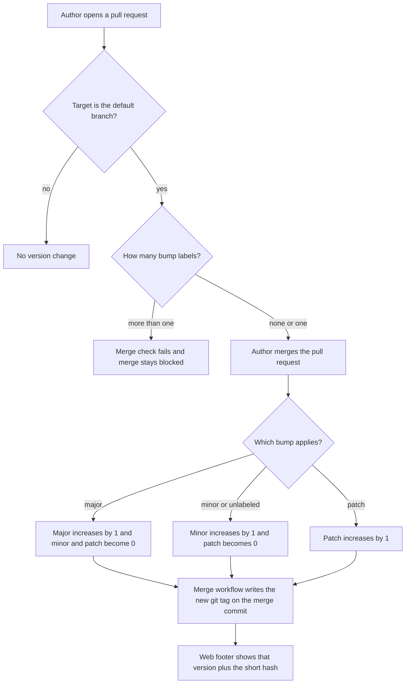

# Version from git tags

* **Status:** Accepted
* **Date:** 2026-11-06

## Background

Keel already shows a product version in the web footer as `Keel` plus the running version, read through package metadata ([Persistent version footer](persistent-version-footer.md), [Package version](../version.md)). That number is a literal in `pyproject.toml` and has not been advancing. KEEL-94 asks for an automatic increment.

This record replaces the rule in the persistent version footer that `[project].version` in `pyproject.toml` is the only written version. The footer itself stays.

The product also has a phone app with a separate version. This decision leaves that version where it is.

## Problem Statement

People cannot tell a new build of Keel from an old one, because nothing advances the version when software merges. The number is also easy to store twice and let copies drift.

## Objective(s)

- Advance major, minor, or patch when a pull request merges to the default branch.
- Show that version, plus the short commit hash, anywhere the Python package already shows its version.
- Keep a single stored copy of the version: git tags for the three numbers, and the commit hash for the build.
- Stop a merge that asks for two different bumps at once.
- Leave the footer, the phone app, and the rest of the page chrome as they are.

## Scope and Deliverables

### In-Scope

- PEP 440 versions. SemVer 2.0.0 applies where it fits PEP 440. PEP 440 wins on a conflict.
- Git tags of the form `vMAJOR.MINOR.PATCH` as the stored major, minor, and patch.
- The short commit hash as the PEP 440 local version.
- `setuptools-scm` as the generator that feeds package metadata from git.
- Pull request labels `bump:major`, `bump:minor`, and `bump:patch`, applied by a person.
- No bump label means minor.
- A merge check on pull requests that target the default branch.
- A GitHub Actions workflow, on merge to the default branch, that writes the new tag.
- The existing web footer and the application version that already read package metadata.
- An initial tag for the current package version, with no bump, when the system is introduced.
- Replacing the written rule that `pyproject.toml` is the version source of truth.

### Out-of-Scope

- The phone app version.
- Pull requests that do not target the default branch.
- Direct pushes to the default branch.
- Pre-release, post, and dev releases as a product channel.
- A new screen, a new footer, or a change to who can see the footer.
- Writing the version back into a source file on each merge.
- Numbering or renaming historical tags that do not exist yet.

### Deliverables

- Labels `bump:major`, `bump:minor`, and `bump:patch`.
- A status check that fails when more than one of those labels is present, and that GitHub requires before merge to the default branch.
- A merge workflow that publishes `vMAJOR.MINOR.PATCH` on the merge commit.
- Package metadata filled from git, with no version literal in the software.
- The existing footer showing `Keel` plus `MAJOR.MINOR.PATCH+<short hash>`.
- This decision, plus version docs that point at git tags.

## Technical Requirements

* **Must** use a PEP 440 version. Where SemVer 2.0.0 and PEP 440 disagree, PEP 440 wins.
* **Must** take major, minor, and patch from the git tag, and take the build from the short commit hash.
* **Must** present the version as `MAJOR.MINOR.PATCH+<short hash>`. The short hash is what `git rev-parse --short` prints for that commit.
* **Must** feed any running code that needs the version from git, through package metadata generated from that git data.
* **Must** let other tools read the project version from that metadata.
* **Must** increment exactly one of major, minor, or patch when a pull request merges to the default branch (`main`).
* **Must** treat a pull request with no bump label as a minor bump.
* **Must** treat `bump:minor` as a minor bump.
* **Must** reset minor and patch to 0 when major increments.
* **Must** reset patch to 0 when minor increments.
* **Must** increase patch by 1 and leave major and minor unchanged when patch increments.
* **Must** fail the merge check when a pull request targeting the default branch has more than one of `bump:major`, `bump:minor`, and `bump:patch`.
* **Must** run that check again when those labels are added or removed.
* **Must** block merging to the default branch while that check fails.
* **Must** make the merge workflow the publisher of the new tag.
* **Must** bake the running app’s version only after that new tag is on the merge commit, including production deploy.
* **Must** keep the web footer on the same pages, in the same place, reading the same package version as today.
* **Must** present any checkout as the latest reachable tag’s numbers plus that commit’s own short hash, including when the commit is exactly the tag.
* **Must** leave major, minor, and patch unchanged when the worktree has uncommitted edits.
* **Must** tag the current package version, with no bump, when this system is introduced. The next pull request merged to the default branch is the first bump.
* **May** carry any other labels alongside one bump label.
* **May** leave all bump labels off a pull request that targets the default branch.
* **Must Not** increment more than one of major, minor, or patch for a single merge.
* **Must Not** store a second copy of the current version, including a literal in `pyproject.toml`, Python, HTML, tests, or docs.
* **Must Not** bump the phone app version in this story.
* **Must Not** bump on a pull request that targets some other branch. The bump-label check does not block that pull request.
* **Must Not** bump on a direct push.
* **Must Not** publish a version string that violates PEP 440.

## Consequences

* **Good:** Each merge to the default branch has one tag. The footer shows that tag plus the commit hash. A pull request with two bump labels cannot merge. Authors who do not label still get a minor bump.
* **Bad:** `pyproject.toml` no longer contains a version line a person can read. Seeing a new version locally means the clone has the tag and the package metadata has been refreshed. The phone app can show a different version from the site.
* **Risk:** If the app is built before the new tag exists, the footer can show the previous numbers. PEP 440 treats the local hash as part of version ordering, so two builds of the same three numbers are not equal.

The label check, the tag written on merge, and reading that version from git are ready to implement. No further architecture pass is required. The new tag must exist before the running app’s version is baked, including production deploy.

## System Design

### Technical Stack and Architecture

This touches GitHub pull request labels, the status check on pull requests into the default branch, the merge workflow that writes the tag, `setuptools-scm` reading git into package metadata, and the existing web footer plus application version in `src/keel/version.py` and `src/keel/web/templates/base.html`. Production deploy must install a tree that already has the new tag. The phone app is unchanged.

No new service or data model is proposed. The sequencing detail that remains is making the existing deploy wait until the tag is present.

### UML Diagrams

## Supporting Documentation

* [Package version](../version.md)
* [Persistent version footer](persistent-version-footer.md)
* [PEP 440](https://peps.python.org/pep-0440/)
* [Semantic Versioning 2.0.0](https://semver.org/spec/v2.0.0.html)
