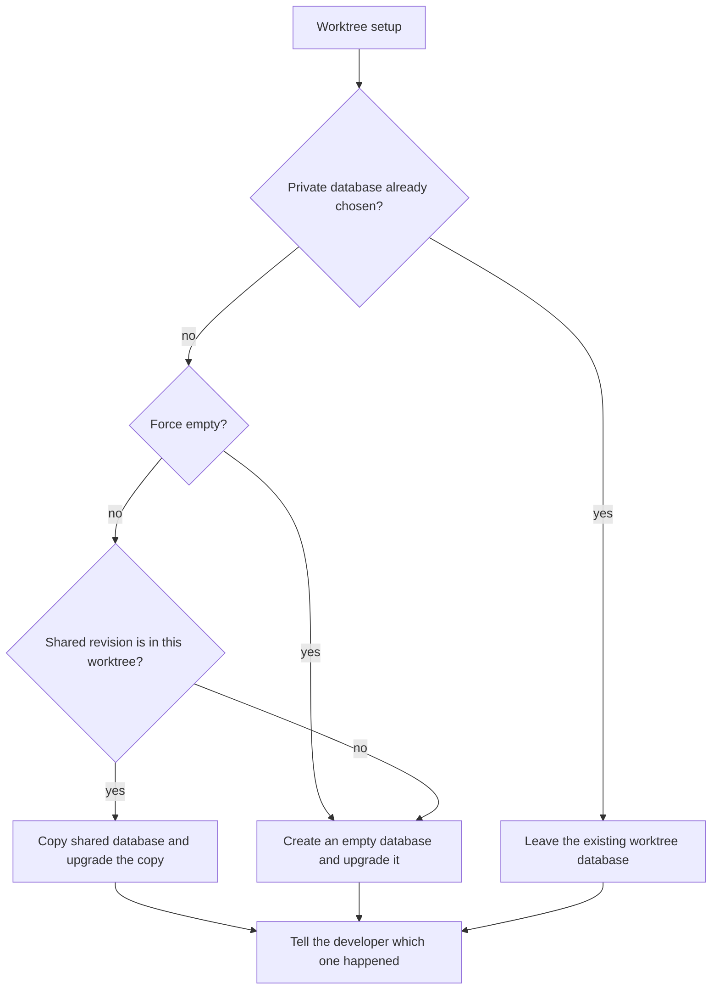

# Worktree-local development database

* **Status:** Accepted
* **Date:** 2026-11-02

## Background

Keel keeps one SQLite file in the OS user-data directory unless `KEEL_DATABASE_URL` is set. [SQLite, SQLAlchemy, and Alembic](sqlite-sqlalchemy-alembic.md) chose that file so a checkout can be copied and upgraded. Onboard copies [`.env.example`](../../.env.example) to `.env` and leaves `KEEL_DATABASE_URL` unset, so every local checkout opens that same file.

Development uses one git worktree per branch, created by [`scripts/deploy-worktree.ps1`](../../scripts/deploy-worktree.ps1) from the latest `origin/main`. Several worktrees are active at once. Each branch can add its own migration. Alembic records a single revision id inside the database. `keel db upgrade` in a worktree fails when that id is not one of the migration scripts in that worktree. That happened here: the shared file is stamped `0028` from the KEEL-128 worktree, and this worktree’s scripts stop at `0027`.

Production on the Pi is a different database. This collision is local development.

## Problem Statement

A migration applied in one worktree stamps the shared development database. Another worktree, whose scripts do not contain that revision, cannot run `keel db upgrade`. The branches are not a single line, and one shared stamp cannot represent all of them.

## Objective(s)

- Let each worktree migrate and run against its own database.
- Leave the main checkout’s database and the production database unchanged.
- Keep a worktree’s database out of git, and remove it when that worktree folder is removed.

## Scope and Deliverables

### In-Scope

- New worktrees created by `deploy-worktree`.
- An existing linked worktree whose `.env` does not yet set `KEEL_DATABASE_URL`, the next time onboard runs there.
- Choosing the file contents: a copy of the shared development database when this worktree can locate that revision, otherwise an empty database migrated with this worktree’s scripts.
- A force-empty flag on `deploy-worktree` so the shared data is not copied.
- A short terminal message saying which choice was made.

### Out-of-Scope

- The production database, and the main checkout’s database.
- Teaching Alembic to store more than one head in one file.
- A mock dataset. Later, when the shared database cannot be copied, that mock should look like a database someone has been using: several people (the `keel` / `keel` account still signs in and remains owner of everything), at least two projects, different access for each person, several sprints, issues that differ in title, description, definition of done, location, priority, assignee, creator, status, start, due, estimate, and remaining time, different repeating schedules, comments from different people, and revision history.
- Reusing a database after the worktree folder is deleted. Creating that branch’s worktree again starts the choice over.

### Deliverables

- This ADR.
- The worktree setup behavior below.

## Technical Requirements

* **Must** point a worktree’s `KEEL_DATABASE_URL` at a database file inside that worktree. `keel` and the app already follow that variable, so serve, upgrade, backup, and restore in the worktree use that file.
* **Must** leave the main checkout and production on their current databases.
* **Must** copy the shared development database only when its current revision is a script in this worktree. Then upgrade the copy to this worktree’s head. The shared file is not modified.
* **Must** create an empty database and upgrade it to this worktree’s head when the shared revision is not in this worktree, when the shared file is missing, or when the force-empty flag is set.
* **Must** say which of those happened, including why a copy was skipped.
* **Must** leave an existing worktree database in place when setup runs again.
* **Must** leave `KEEL_DATABASE_URL` alone when the worktree `.env` already sets it.
* **Must** keep the worktree database out of git. `*.db` and `.env` are already ignored.
* **Must** drop that database when the worktree folder is removed. The shared development database remains.
* **May** provide the force-empty switch only on `deploy-worktree` for a worktree that does not yet have a private database.
* **Must Not** migrate, stamp, or overwrite the shared development database or the production database as part of worktree setup.
* **Must Not** point tests at the worktree database or the shared development database.

## Consequences

* **Good:** One branch can add a migration without blocking upgrade in another worktree. A worktree that can understand the shared revision still starts from that development data.
* **Bad:** A worktree that cannot understand the shared revision starts empty, so the issues in the shared file are not there. The mock that would fill that gap is a later pass. Removing a worktree throws away that worktree’s database.
* **Risk:** Two branches can both add a migration with the same revision id and different contents. Each worktree upgrades only its own file, so they do not collide, and the duplicate id is still a problem when those branches merge.

## System Design

### Technical Stack and Architecture

This uses the existing worktree script, onboard’s `.env`, and the `KEEL_DATABASE_URL` setting the CLI and app already read. The new surface is terminal output from worktree setup. No new screen, role, or service. The main checkout and the Pi stay on their current entry points.

### UML Diagrams

## Supporting Documentation

* [SQLite, SQLAlchemy, and Alembic](sqlite-sqlalchemy-alembic.md)
* [Database backup and restore](database-backup-and-restore.md)
