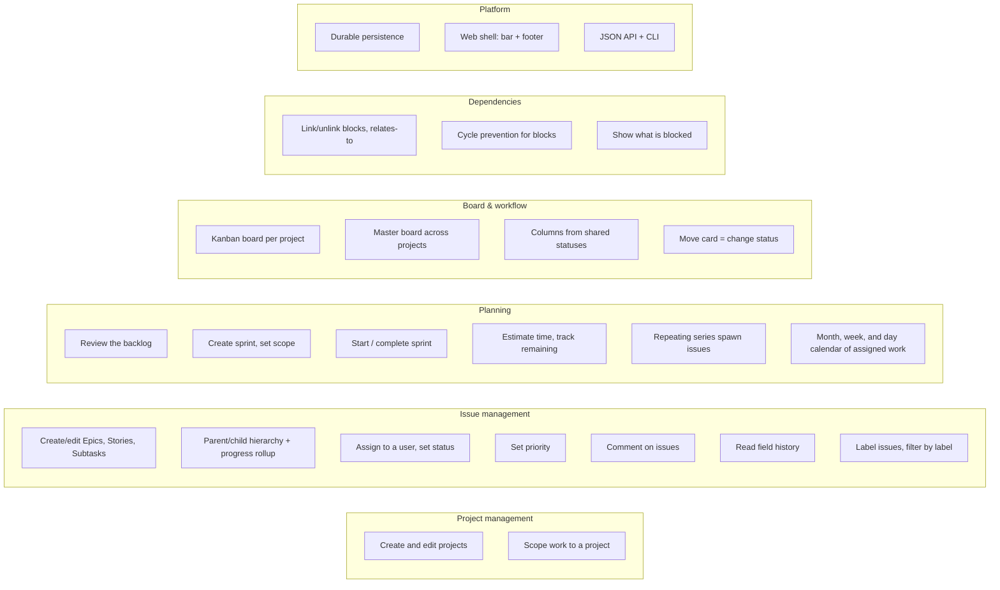

# Capabilities

What the Keel system must be able to do in v1, grouped by domain area. Capabilities describe *what*, not *how*; the entities they act on are defined in the [domain model](domain-model.md).

## Project management

* Create, rename, and describe projects.
* Keep every issue, board, sprint, and backlog scoped to exactly one project.
* Move between multiple coexisting projects.

## Issue management

* Create and edit issues of type Epic, Story, and Subtask (one unified issue — see [ADR 003](../adr/unified-issue-model.md)).
* Maintain the Epic → Story → Subtask parent/child hierarchy.
* Roll up child progress and effort to parent issues.
* Assign an issue to a user and set its reporter.
* Set and change an issue's status within the shared workflow (see [ADR 004](../adr/shared-fixed-workflow.md)).
* Set and change an issue's priority on the five-level scale (see [ADR 030](../adr/ADR-030.md)).
* Add and read comments on an issue. Issue descriptions, definitions of done, and comment bodies render as Markdown on the issue page ([ADR 017](../adr/markdown-descriptions-and-comments.md)).
* Write an issue's definition of done — the criteria for calling it *Done* — in its own panel beneath Description ([Issue definition of done](../adr/issue-definition-of-done.md)).
* Add and remove labels on an issue, and filter the board and issue list by one label ([ADR 031](../adr/ADR-031.md)).
* Read a short per-issue changelog of status, assignee, sprint, estimate, remaining, due date, parent, type, title, description, definition of done, priority, and labels ([ADR 025](../adr/ADR-025.md), [ADR 030](../adr/ADR-030.md), [ADR 031](../adr/ADR-031.md), [Issue definition of done](../adr/issue-definition-of-done.md)).

## Planning

* Present a per-project backlog of unscheduled, unfinished issues in creation order (see [ADR 013](../adr/planning-realization.md), which amends [ADR 005](../adr/boards-sprints-and-backlog.md)).
* Create sprints, add issues to a sprint, and remove them. Sprint menus list active and planned sprints and omit completed ones ([Sprint assignment choices](../adr/sprint-assignment-choices.md)).
* Move a sprint through *planned → active → completed*, with at most one sprint active per project; on completion, carry unfinished issues into the next planned sprint or back to the backlog.
* Optionally run a project's sprints on a cadence so windows open and close without a manual Start or Complete click, and optionally keep the next N sprints planned in advance ([ADR 019](../adr/auto-sprint-cadence.md), [Auto-sprint lookahead](../adr/auto-sprint-lookahead.md)).
* Record a time-based estimate on an issue and update its remaining time as work progresses.
* View estimated and remaining time aggregated from child issues.
* Define a repeating series that spawns ordinary issues on a cadence, including a recipe priority copied onto each copy ([ADR 021](../adr/repeating-work-scheduling-manager.md), [Series recipe priority](../adr/series-recipe-priority.md)).
* Show the acting user's unfinished issues that have a start or due date on a month, week, or day calendar at `/calendar`, and that project's unfinished dated issues at `/projects/{key}/calendar`, as a bar from the start day through the due day ([Calendar of assigned work](../adr/month-calendar.md)).

## Board & workflow

* Present a project's issues on a Kanban board.
* Present a master Kanban of current work from every project at `/board`, reachable from Board when no project is in context ([ADR 032](../adr/ADR-032.md)).
* Show a Story or Subtask's parent key on its board card when it has a parent, and color Epic, Story, and Subtask distinctly wherever type is shown ([ADR 027](../adr/ADR-027.md)).
* Derive board columns from the shared workflow statuses.
* Restrict the board to chosen issue types, to a chosen assignee, to a chosen sprint, and to a chosen label; on the master board, also to a chosen project.
* Separate the board into a row of columns per sprint; on the master board, prefix those rows with the project key and refuse a drop onto another project's sprint. A completed sprint is not a row, and its Done and Cancelled issues stay off both boards ([Completed sprints off the board](../adr/completed-sprints-off-the-board.md)).
* Change an issue's status by moving its card between columns.

## Dependencies

* Create and remove directed, typed links between issues — *blocks* and *relates-to* (see [ADR 006](../adr/ticket-dependencies.md)), including between issues in different projects (see [ADR 014](../adr/cross-project-dependencies.md)).
* Refuse a *blocks* link that would introduce a cycle anywhere in the blocking graph.
* Show, for a given issue, what it blocks / is blocked by and what it relates to, and mark unresolved blockers on board cards and backlog rows.

## Platform

* Durably persist all entities so work survives restarts (realized per [ADR 007](../adr/sqlite-sqlalchemy-alembic.md); schema in the [data model](../design/data-model.md)).
* Present the web UI within the existing shared chrome: sticky top menu bar ([ADR 001](../adr/persistent-top-menu-bar.md)) and version footer ([ADR 002](../adr/persistent-version-footer.md)), using the recorded [brand colors](../brand-colors.md). `/` is the acting user's inbox across projects ([ADR 022](../adr/personal-work-inbox.md)), including a Now panel for assigned work that has started, is due or overdue, or is In Progress ([Now on the home inbox](../adr/now-home-panel.md)), dated work due later this week and later this month ([Due this week and due this month as separate home panels](../adr/due-this-week-and-due-this-month-home-panels.md)), and assigned work that became Done today ([Completed today on the home inbox](../adr/completed-today-home-panel.md)); non-empty sections can be minimized and restored from a browser cookie ([Collapsible home inbox sections](../adr/collapsible-home-inbox-sections.md)), and this browser can remove, restore, and reorder those panels ([Customizable home panels](../adr/customizable-home-panels.md)). A phone-narrow viewport uses the same pages with a Menu control for the section links ([Phone menu](../adr/phone-menu.md)), swipeable board and tables, and the footer at the end of the page ([ADR 018](../adr/phone-layout.md)).
* Find an issue, project, sprint, or user from the top bar by key or name ([ADR 016](../adr/find-from-the-top-bar.md)).
* Continue to expose the JSON API and the `keel` CLI as the existing platform does.

## Related documents

* [Context](context.md)
* [Use cases](use-cases.md)
* [Domain model](domain-model.md)
* [v1 scope](v1-scope.md)
* [Implementation plan](../design/implementation-plan.md)
* [API reference](../design/api.md)
* [UI design](../design/ui.md)
* [ADR 018: Phone layout of the existing site](../adr/phone-layout.md)
* [ADR 025: Lightweight per-issue field history](../adr/ADR-025.md)
* [ADR 027: Parent key on Kanban cards and type colors](../adr/ADR-027.md)
* [ADR 032: Master board across all projects](../adr/ADR-032.md)
* [Completed sprints off the board](../adr/completed-sprints-off-the-board.md)
